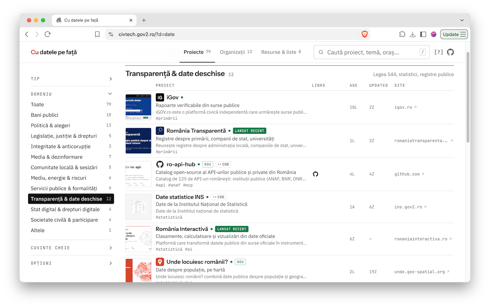
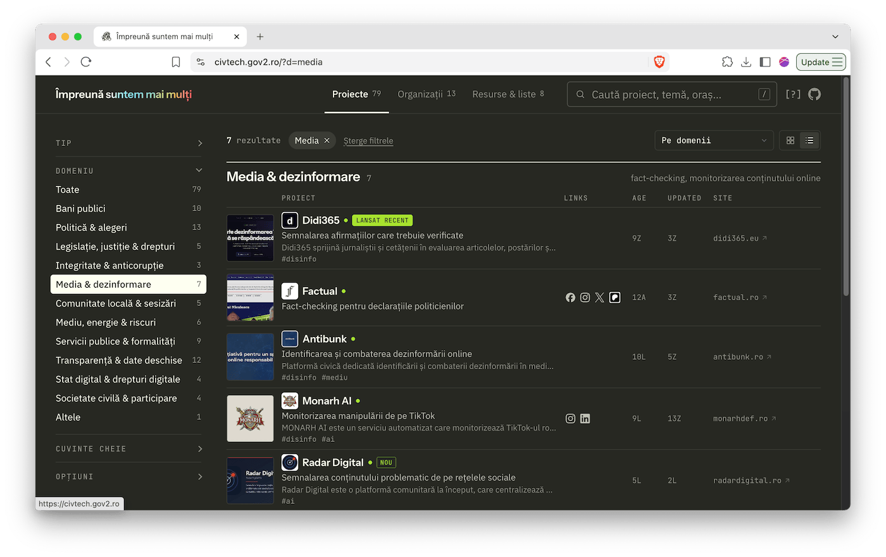

[civtech.gov2.ro](https://civtech.gov2.ro/) &middot; listă de proiecte &amp; resurse de civtech, transparență, bună administrație și tot așa &rarr; [proiecte.csv](data/proiecte.csv). Vezi și [roadmap/backlog](docs/BACKLOG.md), [arhitectura](docs/ARCHITECTURE.md) &amp; [schema datelor](docs/DATA-SCHEMA.md).

_Notă_: Verificarea datelor **nu este încă finalizată**.

Pentru erate sau sugestii de resurse noi, submit a PR sau issue, sau via [Google Form](https://forms.gle/wswqrm7P4QV25NZx7).




# 🤖🗯️

## Layout
Human-edited data is CSV, so it can be changed in a PR or round-tripped through Google Sheets. See [CONTRIBUTING.md](CONTRIBUTING.md) for every column.
- `data/proiecte.csv` — projects and resources (`fel`)
- `data/orgs.csv` — organisations
- `data/taxonomy.json` — domenii, tipuri, acoperire, keyword cleaning rules, link roles
- `data/profil.csv` — generated by the profiler: HTTP status, redirects, meta description, image, icon, repos, social links (JSON cell), Wayback link
- `data/international.csv` — international entries, same columns as `proiecte.csv`, kept for the future international mirror
- `data/mentiuni.csv` — generated by `search.py`: web mentions per entry; only the `editor` column is edited by hand
- `site/` — static site; `site/data.json`, `site/feed.xml` and `site/img/` are build output, not edited

## Run
```sh
python3 scripts/validate.py                  # check the CSVs (CI runs it on every push and PR)
python3 scripts/build.py                     # merge everything into site/data.json and site/feed.xml
python3 -m http.server -d site 8000          # preview at http://localhost:8000

uv run scripts/profile.py                    # profile entries not in profil.csv yet (--only slug,slug; --force for all)
uv run scripts/profile.py --extra            # age, activity, volume, repos, certificates, Wikipedia links (free)
uv run scripts/search.py --only slug,slug    # web mentions via Serper + Brave (paid, ~3 requests per entry)
uv run scripts/search.py --prune-only        # re-apply the pruning rules to data/mentiuni.csv (no requests)
uv run scripts/review.py --limit 5           # Claude Haiku suggestions → data/review/sugestii.csv (--dry-run to inspect)
```
`profile.py`, `search.py` and `review.py` need [uv](https://docs.astral.sh/uv/). Keys and local settings live in
`.env` at the repo root (gitignored, never committed): `SERPER_API_KEY`, `BRAVE_API_KEY`, `ANTHROPIC_API_KEY`,
`GITHUB_TOKEN` (optional), `GOOGLE_APPLICATION_CREDENTIALS` (path to the service-account JSON, kept outside the repo)
and `SHEET_ID`. Load them with `set -a; source .env; set +a` before a paid or keyed run.

## Editing the data

You edit three files: `data/proiecte.csv`, `data/orgs.csv` and (rarely) `data/taxonomy.json`. Every other file
under `data/` and `site/` is generated. [CONTRIBUTING.md](CONTRIBUTING.md) describes each column.

Open the CSVs in a text editor, LibreOffice or Excel. Save as UTF-8 with commas, and keep the header row as it is.
A cell with a comma or a line break must be in quotes; spreadsheet programs do this for you.

### What to run after an edit

| You changed | Run |
| --- | --- |
| Text only: name, description, domain, type, keywords, author, coverage, `stare` | `validate.py`, then `build.py` |
| `linkuri` | `validate.py`, then `build.py` |
| `url` (a moved site), or you added a row | `profile.py --only <slug>`, then `search.py --only <slug>`, then `validate.py` and `build.py` |
| a `slug` | Avoid it. The old slug's profile, images and search results stay behind under the old name. If you must, rename it also in `data/profil.csv` and `data/mentiuni.csv`, then run `build.py` |
| `data/taxonomy.json` | `validate.py`, then `build.py` |

Then commit and push. On every push to `main`, GitHub runs `validate.py` and `build.py` again and publishes
`site/`. CI does **not** run `profile.py` or `search.py`: run those on your machine and commit their output
(`data/profil.csv`, `data/mentiuni.csv`, `site/img/`).

### Change a property
Edit the cell. To mark a dead or finished project, set `stare` to `offline` or `arhivat`: it leaves the main list.
An offline site with no Wayback capture for a year shows as `arhivat` without an edit.

### Delete an entry
Delete its row in `proiecte.csv` or `orgs.csv`, then run `validate.py` and `build.py`. Its rows in
`profil.csv` and `mentiuni.csv` can stay: nothing shows an entry that is not in the two CSVs, and the
`editor` marks come back if you add the entry again.

### Add an entry: `/add-new-url`
In Claude Code, in this repo, type `/add-new-url <url>` (for example `/add-new-url techandtonic.ro`).
Claude checks for a duplicate, reads the site, writes the row (project, resource or organisation), runs
`profile.py`, `search.py`, `validate.py` and `build.py`, and reports every cell with its source. It does not
commit. The command lives in `.claude/commands/add-new-url.md`.

To add a row by hand instead, fill at least `slug`, `nume`, `url`, `domeniu` and `acoperire` (and `fel` in
`proiecte.csv`), then follow the "added a row" line in the table above.

### Prune search results
In `data/mentiuni.csv`, set the `editor` column to `1` (keep) or `0` (drop). Leave the other columns alone.
Then run `search.py --prune-only` and `build.py`.

## Editing in Google Sheets

The Sheet `civtech.gov2.ro` has two tabs, `proiecte` and `orgs`. Row 1 of each tab holds the column names of the
CSV, in the same order. The repo stays the source of truth. `scripts/sheets.py` and two workflows keep the Sheet
and the CSVs in step.

**Sheet → repo (`sheets-pull`).** The workflow runs every 6 hours, and on demand (*Actions → sheets-pull → Run
workflow*). It reads the Sheet and, if a CSV changed, runs `validate.py` and `build.py` and opens one pull request
from the branch `sheets-sync`, "Sheets: modificări din tabel". The text of the pull request lists the changed rows
and the output of `validate.py`. You review the pull request and merge it. The workflow never pushes to `main`.
It runs `validate.py` itself, because a pull request opened by a workflow does not start `validate.yml`.

**Repo → Sheet (`sheets-push`).** When a push to `main` changes `data/proiecte.csv` or `data/orgs.csv`, the workflow
rewrites both tabs from the CSVs. Every cell is plain text, row 1 is frozen and bold, and the columns `fel`,
`domeniu`, `tip`, `acoperire`, `stare` and `civictech` have drop-downs from `data/taxonomy.json`. The workflow
never overwrites an edit that is not in the repo yet. It compares the Sheet with the CSVs of the push's previous
commit (`--since`). If the Sheet holds a change that is neither in those CSVs nor in the new ones, the job fails
with "Tabelul are modificări nesincronizate; rulează sheets-pull". Run `sheets-pull`, merge the pull request, and the
next push writes the Sheet. A pull request that came from the Sheet needs no such step: its changes are in the
new CSVs, so the check passes.

Both workflows share one queue, so they never run at the same time.

**Rules for the editor**
- Do not change row 1 or the column order. `pull` stops with an error that names the difference.
- Do not write to the right of the last column.
- A row deleted in the Sheet is a deleted entry in the pull request.
- `pull` copies the Sheet as it is: it strips trailing spaces and drops empty rows, and nothing more. If you edit a
  CSV on `main` and the Sheet in the same hours, the pull request shows the Sheet's old value as a revert. Merge
  only what you want.
- A new column goes into `PROIECTE_COLS` or `ORGS_COLS` in `scripts/common.py` first. Then run `sheets.py push
  --force` once, so that row 1 of the Sheet has the new column.

**By hand** (needs [uv](https://docs.astral.sh/uv/) and `.env`, see above):
```sh
set -a; source .env; set +a
uv run scripts/sheets.py diff                 # Sheet vs the CSVs: rows added / removed / changed; no writes
uv run scripts/sheets.py pull                 # Sheet -> data/proiecte.csv, data/orgs.csv (then: git diff)
uv run scripts/sheets.py push --since <ref>   # CSVs -> Sheet; <ref> = the commit the Sheet was last synced from
uv run scripts/sheets.py push                 # same, but refuses if the Sheet differs from the current CSVs
uv run scripts/sheets.py push --force         # no check: the Sheet becomes a copy of the CSVs
```
Exit code 3 means that the Sheet holds edits not yet in the repo; nothing was written. In GitHub, run
*Actions → sheets-push → Run workflow* with the input `since` (or `force`) to run a push by hand.

### Formular (the proposal Form)

The Form "Sugestii listă civtech.gov2.ro" sends its answers to the tab `propuneri` of the same Sheet. The script
`scripts/form.py` writes the questions of the Form from the data model, so that the choices always match
`data/taxonomy.json`. Run it after a change in the taxonomy.
```sh
uv run scripts/form.py                         # print the planned questions and the Form as it is now; no writes
uv run scripts/form.py --save                  # store the Form, as you edited it in Google Forms, in data/form.json
uv run scripts/form.py --apply                 # replace ALL items of the Form with the planned ones
```
The scripts read `.env` themselves. To change wording, help texts, order or required flags, edit the Form in
Google Forms and run `--save`: `data/form.json` becomes the template, and a later `--apply` (for example after a
taxonomy change) keeps your edits. The choices of "Ce propui?", "Domeniu", "Tip" and "Acoperire" always come from
the taxonomy, so keep those four titles as they are.
- `--apply` deletes every existing item of the Form and creates the 13 planned questions, in one request. It does not
  change the title, the description, the settings or the response destination of the Form.
- The columns of `propuneri` are named after the question titles. The list `TITLES` at the top of `form.py` holds
  them. Renaming a title renames a column, so change a title only together with whatever reads `propuneri`.
- `ANSWER_KEYS` in `form.py` maps each choice label to its key in the CSV (`Bani publici` → `bani`).
- The Form API cannot validate a URL. `validate.py` checks the URL when you copy an answer into a CSV.
- Give the service account *Editor* access to the Form, and enable the **Google Forms API** in the Google Cloud
  project. Put the Form's ID (the part of the edit URL between `/d/` and `/edit`) in `.env` as `FORM_ID`.

### Set up (once)

1. **The spreadsheet.** One Google Sheet with two tabs named `proiecte` and `orgs`. Note the Sheet ID: the part
   of the URL between `/d/` and `/edit`. `sheets.py push` fills the tabs and sets the formats, so you do not
   need to prepare them. To fill a Sheet by hand instead: *File → Import → Upload* a CSV, with *Convert text to
   numbers, dates and formulas: No*.
2. **A Google Cloud project.** At [console.cloud.google.com](https://console.cloud.google.com/), create a
   project (e.g. `civtech-sync`). In *APIs & Services → Library*, enable the **Google Sheets API**.
3. **A service account.** In *IAM & Admin → Service accounts*, create one (e.g. `civtech-sheets`). It needs no
   project role. Open it → *Keys → Add key → Create new key → JSON*, and download the file. If your Google
   Workspace blocks key creation (policy `iam.disableServiceAccountKeyCreation`), an admin must allow it for
   this project.
4. **Share the Sheet** with the service account's e-mail (`…@<project>.iam.gserviceaccount.com`) as *Editor*.
   Share only this one Sheet with it.
5. **GitHub.** In the repo, *Settings → Secrets and variables → Actions*: add the secret `GOOGLE_SA_KEY` (the
   whole JSON file) and the variable `SHEET_ID`. Then keep the JSON file outside the repo, or delete it.
6. **Pull requests from workflows.** In *Settings → Actions → General → Workflow permissions*, tick *Allow GitHub
   Actions to create and approve pull requests*. Without it, `sheets-pull` cannot open the pull request.
7. **Locally** (optional): put `GOOGLE_APPLICATION_CREDENTIALS` (path to the JSON file) and `SHEET_ID` in `.env`.

The workflows run on a schedule, on pushes to `main` and by hand only, because GitHub does not give secrets to
pull requests from forks.

-----

 
Copyright (c) 2026 [gov2.ro](https://gov2.ro)
Date reutilizabile conform [EUPL v1.2](https://joinup.ec.europa.eu/collection/eupl/eupl-text-eupl-12) (the "Licence")