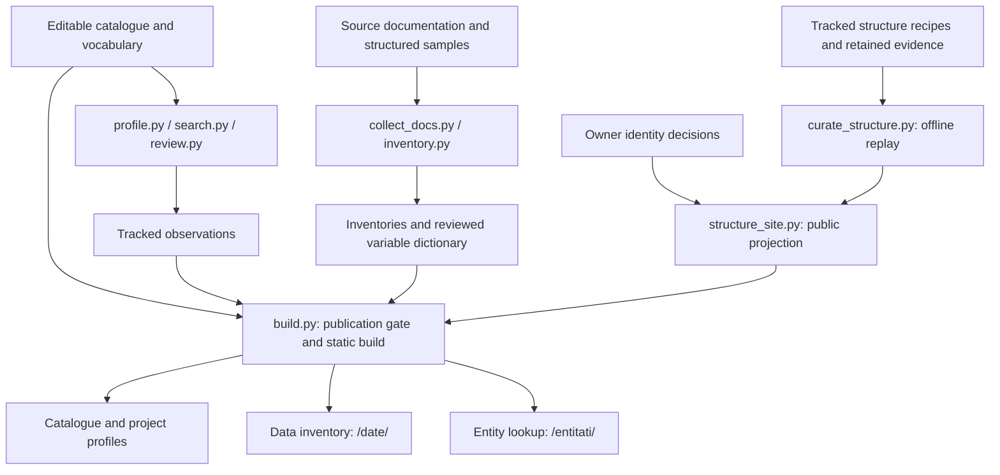

# Architecture

CivTech România is a static catalogue at [civtech.gov2.ro](https://civtech.gov2.ro/).
Python scripts build its files. Plain JavaScript provides search and filters in the browser.
There is no application server or database.

## The public source

`common.PUBLIC_ROOT` selects `data/taxonomy-v2/integrare/`.
This editable integration copy became the public source on 2026-10-22.
Its vocabulary lives in the parent `data/taxonomy-v2/` directory.
The frozen v1 files remain available through `--data-dir data` for rollback and comparison.
They are not the default source.

| Input | Actor and purpose |
| --- | --- |
| `integrare/intrari.csv` | Editors maintain entries, classifications, descriptions and links. |
| `integrare/relatii.csv` | Editors record relations, including accepted data-provider relations. |
| `integrare/revizuire.csv` | The owner records review decisions. |
| `concepte.csv`, `arii.csv`, `valori.csv` | Editors maintain the controlled vocabulary. |
| `roluri-linkuri.csv`, `gazde-linkuri.csv` | Editors maintain link roles and host rules. |
| `inventar-concepte.json`, `inventar-note.json` | Editors review variable meanings, selectors and candidate members. |
| `colectare-interzisa.csv` | Editors record hosts that scripts must not request. |
| `structura/recipes/` | Evidence-backed recipes describe site sections, URL patterns, APIs and identifiers. |
| `structura/decisions.json` | The owner accepts, rejects or defers identity assertions. |

`docs/DATA-SCHEMA.md` defines the columns and stored formats.
`CONTRIBUTING.md` explains catalogue edits in Romanian.
Do not write into the sealed `source/`, `reference/` or `runs/` directories.

## From sources to the website



The build makes no source-site requests and needs no API credentials.
It uses tracked observations and retained evidence.
Ignored discovery caches are not required for publication.
The publication gate accepts reviewed catalogue classifications and excludes hidden entries from every public projection.

### Health observations

`profile.py` writes `observatii/profil.csv` and image assets.
It measures availability, documentation links, repository activity, age and related signals.
`search.py` writes mentions and preserves the editor's keep/drop column.
`review.py` labels retained mentions. It does not edit catalogue entries.
These scripts declare dependencies through PEP 723 and run with `uv run`.

The build derives displayed status, dates and relevance scores from these observations.
An observation time records a check, not a project's launch or legal validity.
The [methodology](METODOLOGIE.md) explains the calculations and their limits.
The structure profiler is separate from this health workflow.

### Data inventory

`collect_docs.py` retains bounded documentation copies with provenance.
`inventory.py` extracts field metadata from supported structured sources.
Tracked inventories live under `observatii/inventare/`.
Facts distinguish declarations, observed samples and unknown values.
Source roles distinguish inputs, outputs, documentation and project-use evidence.

The variable dictionary groups fields through constrained selectors and evidence-backed meanings.
Accepted `date_din` relations supply provider labels.
An institution targeted by a project does not thereby become its data provider.
A common variable does not establish that two datasets can be joined.

`inventory_site.py` publishes the finder at `/date/`, the overview at `/date/lista/`, and project inventories.
It also writes local JSON payloads under `/inventar/` and pages for variable groups.
The finder excludes inactive entries, organisations and entries classified without data.
Missing inventories do not imply that a project has no data.
The catalogue drawer loads field details only when a person opens them.

### Site structure and entity identity

`profile_structure.py` collects bounded structure observations into an isolated store.
Discovery can inspect permitted robots rules, sitemaps, `llms.txt`, linked documentation and declared GET APIs.
Failed refreshes preserve earlier evidence and mark its applicability.
The [profiler guide](STRUCTURE-PROFILER.md) explains collection and its limits.

Versioned recipes retain semantic interpretations separately from generated discovery stores.
They describe collections, section URLs, typed URL placeholders, API operations and identifier namespaces.
Each claim retains a source URL, observation time, hash and precise evidence locator.
A collection is not necessarily a distinct site section.
A route variable is not a CUI merely because it contains digits.

For publication, `structure_site.py` replays the tracked recipes in a temporary directory.
It projects observations only for selected catalogue entries whose source URLs still match.
Project profiles receive sections, URL patterns, API declarations and evidence receipts.
`/entitati/data.json` receives observed record references and eligible accepted identity links.
Raw bodies, local file paths, request journals and editorial notes stay out of browser payloads.

An identifier scope includes its namespace and issuer.
A local scope also includes its project.
The lookup matches exact strings after trimming surrounding input spaces.
It preserves case, punctuation, prefixes and leading zeroes.
CUI identifiers, territory SIRUTA codes and local record identifiers remain distinct.
Buyer, supplier, parent and location identifiers do not identify the enclosing record.

Only explicit accepted owner decisions can confirm a correspondence.
Conflicts, hidden records and missing endpoints suppress that confirmation.
The lookup expands direct accepted pairs; it does not infer transitive entity clusters.
Equal identifiers can therefore appear as observations without a confirmed correspondence.
Publishing the feature does not accept pending assertions.
A URL constructed from a typed template remains labelled as availability unverified.
The browser reads local payloads and contacts a source project only when a person follows its link.

## Build modes and navigation

The production workflows use:

```sh
python3 scripts/validate.py --publication
python3 scripts/build.py --with-inventory --with-structure
```

`--with-structure` also enables the data inventory.
The main menu contains **Inventar de date**, which opens `/date/`.
That page links to **Entități între proiecte** at `/entitati/`.
The lookup links back to the inventory. Project profiles also offer contextual lookup links.

An isolated build uses the same public inputs:

```sh
python3 scripts/build.py --with-structure --site-dir /tmp/civtech-preview
python3 -m http.server -d /tmp/civtech-preview 8000
```

A plain build omits both optional projections and removes their previous outputs.
`--with-inventory` alone publishes the inventory without an entity link.
The JSON feature keys `inventoryPreview` and `structurePreview` retain their historical names.
They indicate included features, not pending editorial acceptance.

`--structure-store DIR` permits inspection of another checked store only with a separate `--site-dir`.
Public builds always replay the tracked recipes and use the repository's owner decisions.
`--allow-draft` permits proposed catalogue classifications only in an isolated output directory.
A different data root cannot write the public `site/` directory.

## Browser and generated files

`build.py` writes `site/data.json`, the feed, `llms.txt`, entry pages and archive pages.
Entry paths use `/proiect/<slug>/`, `/organizatie/<slug>/` or `/resursa/<slug>/`.
Generated entry pages carry `<base href="../../">`; JavaScript uses `ROOT` for data paths.
Assets and links must also resolve when a person opens a direct entry URL.

`site/app.js` keeps filters, sort and the open entry in the URL.
Theme and display preferences use local storage.
`site/inventory.js` and `site/entities.js` keep their searches in URL parameters.
Each interface handles failed payload loads and browser history.

The build stamps asset hashes into generated pages and `site/index.html`.
Commit the stamped index after changing its CSS or JavaScript.
Do not hand-edit generated data, pages or image assets.
The build regenerates ignored projection directories during deployment.

## How the site is published

`.github/workflows/validate.yml` checks the publication gate, builds and unit tests.
It also checks the taxonomy package, JavaScript syntax, workflows and browser behavior.
The browser job includes the catalogue, inventory, variable finder and entity lookup.

`.github/workflows/pages.yml` validates and builds both projections after a push to `main`.
It uploads `site/` and deploys the artifact to GitHub Pages.
No feature branch merge is required when the changes already share `main`.
A release tag records a deliverable; a GitHub Release is published only when requested.

## Editing in Google Sheets

The Sheet mirrors the editable v2 root through `scripts/sheets.py`.
The catalogue tab is `v2-intrari`; the review tab is `v2-revizuire`.
The `_sync` tab records the last successful sync state.

A scheduled pull runs every six hours and opens or updates a `sheets-sync` pull request.
Three-way comparison detects conflicting cell edits.
Validation failures remain visible on the pull request and fail its status.
The workflow does not silently merge those changes.

After a catalogue change reaches `main`, the push workflow updates the Sheet.
It refuses to overwrite unsynced Sheet edits and writes its sync marker last.
The frozen v1 tabs remain accessible only through an explicit v1 data root.
Credentials and Sheet identifiers come from environment variables or GitHub secrets.

## Proposals through the Google Form

The public Form collects proposals; it does not write accepted catalogue entries.
For v2, `form.py` prints a question plan and refuses `--apply`.
It can import a `propuneri` export into proposed entry rows for editorial review.
The legacy Form update path remains available for an explicit v1 root.

## Local review and skills

`review_ui.py` binds to localhost and never commits.
It records provider decisions, variable group decisions and candidate-member decisions atomically.
It does not decide for the owner.
Identity decisions remain a separate durable file in `structura/`.

The repository's [add-new-url skill](../.agents/skills/add-new-url/SKILL.md) guides catalogue enrollment.
The [profile-structure skill](../.agents/skills/profile-structure/SKILL.md) guides structure profiling and identity curation.
Neither workflow can turn an unreviewed identity proposal into an accepted link.

<a id="taxonomy-v2-preview"></a>

## Taxonomy v2

Taxonomy v2 is the public model, not a separate preview application.
`taxonomy_v2.py` validates entries, vocabulary references and publication states.
The detached integration copy is editable; `integrare.py` verifies its recorded detach boundary.
`cutover_v2.py --plan` reports the already-applied migration.
Historical specs and sealed runs document the migration; they are not current editing targets.

## Keys and secrets

Only collection and external sync stages need credentials.
Search uses `SERPER_API_KEY` and `BRAVE_API_KEY`; mention review uses `ANTHROPIC_API_KEY`.
Optional PageRank uses `OPR_API_KEY`.
Sheet and Form operations use their configured identifiers and Google credentials.
Keep values outside versioned files and never copy them into retained evidence or browser payloads.

## Known limits

- Inventories and record samples are partial. Missing observations do not establish absence on a source site.
- Observation times describe evidence freshness. They do not establish legal validity periods.
- Source declarations and successful API responses remain separate access facts.
- The structure engine does not execute GraphQL, run paid search or crawl repositories automatically.
- Listed hosts receive no automated request, including redirects. A failed or blocked request does not authorize a browser bypass.
- Variable groups describe compatible meanings. Identity links require separate evidence and an owner decision.
- The static site queries retained records. It does not search every source project live.
