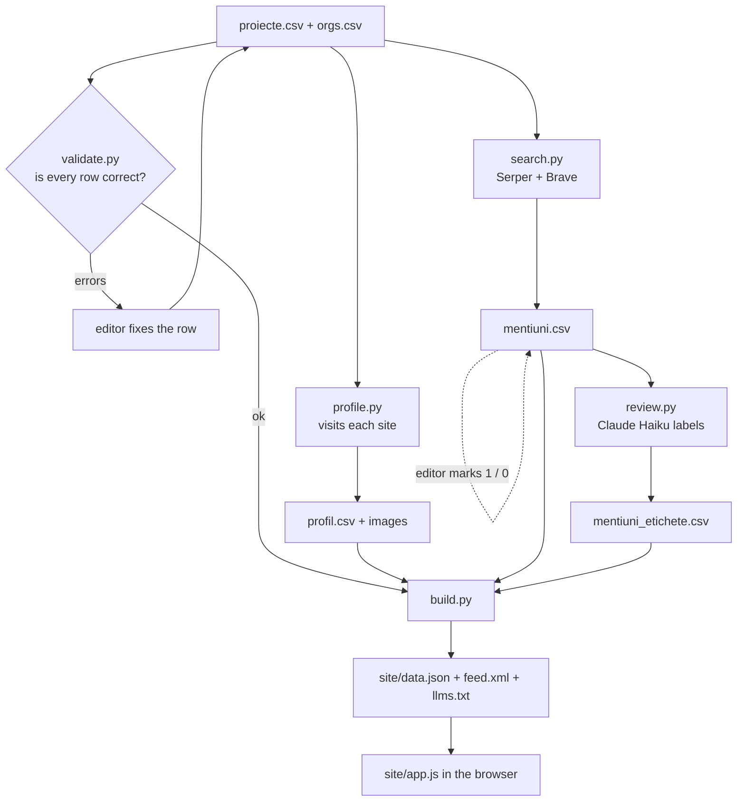
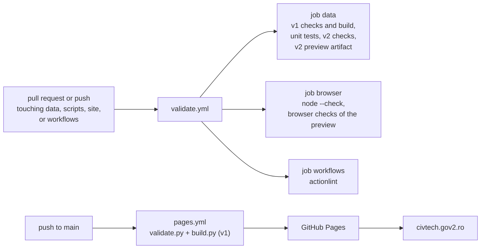
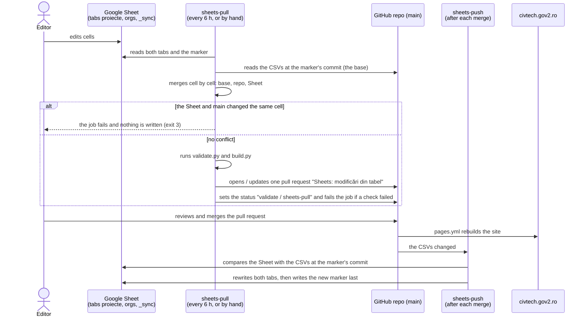
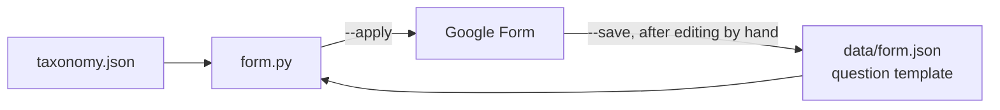
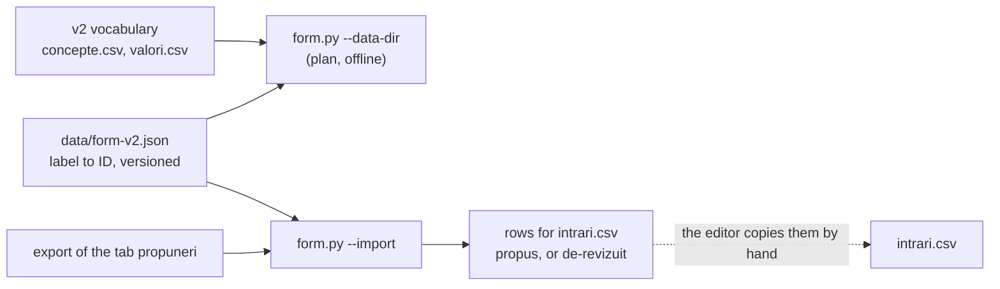
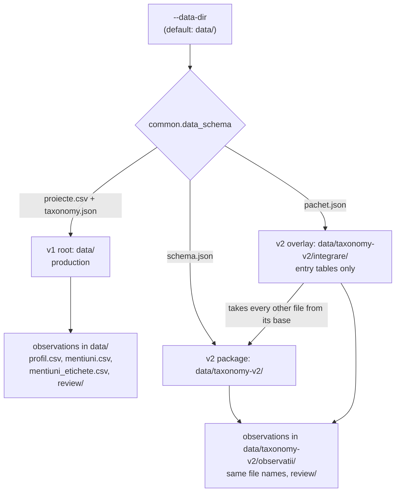
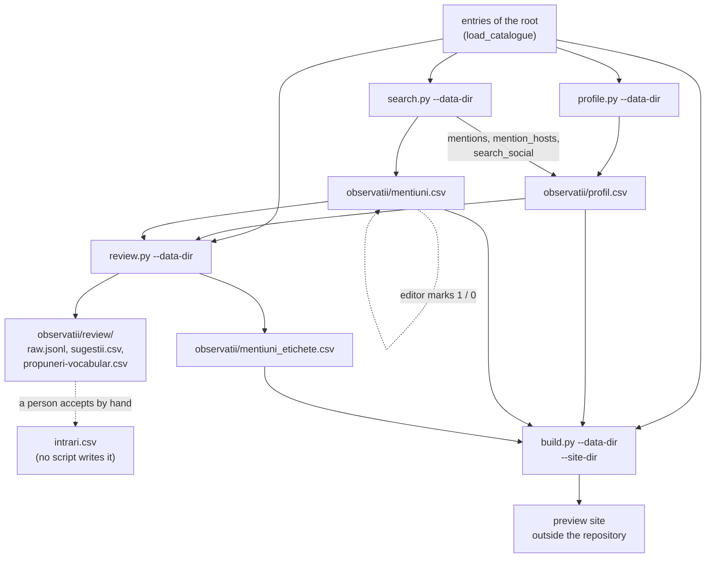

# Architecture

How CivTech România is put together: where the data lives, who changes it, and how a change reaches
the site at [civtech.gov2.ro](https://civtech.gov2.ro/).

## The short version

_Status, 2026-10-22: the cutover to taxonomy v2 is applied. The public source is `data/taxonomy-v2/integrare/` (`intrari.csv` and its vocabulary), `site/app.js` is the v2 browser code, and the workflows use the tab `v2-intrari`. The text below that speaks of `data/proiecte.csv` and `data/orgs.csv` as the source describes the frozen v1 flow, which stays for the rollback._

- The catalogue is **two spreadsheets in the repository**: `data/proiecte.csv` (projects and
  resources) and `data/orgs.csv` (organisations). They are the source of truth.
- A few **scripts** read those files, look at each website, and produce one file for the browser:
  `site/data.json`.
- The **site** is plain HTML and JavaScript. It loads `data.json` and does all filtering and sorting
  in the browser. There is no server and no database.
- **GitHub** stores everything, checks every change, and publishes the site.
- A **Google Sheet** is a second place to edit the two CSVs, and a **Google Form** collects
  proposals from the public. Both connect to the repository through GitHub workflows.
- **Taxonomy v2** is the classification model of the public site since the cutover of 2026-10-22. It lives in `data/taxonomy-v2/`.
  Most of this page still describes the v1 model, which stays for the rollback. See [Taxonomy v2 (preview)](#taxonomy-v2-preview).


## The data files

| File | Who writes it | What it holds |
| --- | --- | --- |
| `data/proiecte.csv` | the editor (by hand, in the Sheet, or with `/add-new-url`) | projects and resources |
| `data/orgs.csv` | the editor | organisations |
| `data/taxonomy.json` | the editor, rarely | the allowed domains, types, coverage values, keyword rules, link types |
| `data/site.json` | the editor | the addresses for "report a problem" |
| `data/profil.csv` | `profile.py` | what the profiler saw on each site: status, image, dates, GitHub stats |
| `data/mentiuni.csv` | `search.py` (plus the `editor` column, by hand) | pages elsewhere on the web that mention each entry |
| `data/mentiuni_etichete.csv` | `review.py` | Claude Haiku's labels for those mentions (news, research, independent…) |
| `data/review/` | `review.py` | the model's raw answers and its suggested corrections; local, the repository ignores them |
| `data/form.json` | `form.py --save` | the template of the Google Form's questions |
| `site/data.json`, `site/feed.xml`, `site/llms.txt`, `site/img/` | `build.py`, `profile.py` | what the site shows |
| `data/taxonomy-v2/` | the editor, `integrare.py`, the enrichment scripts | the v2 draft: vocabulary, classifications, review queue, observations. The public site does not read it. |
| `data/form-v2.json` | `form.py --write-map` | the label-to-ID map of the planned v2 Form |

Rule of thumb: a person edits `proiecte.csv`, `orgs.csv`, `taxonomy.json`, `site.json` and the `editor` column of
`mentiuni.csv`. Scripts write the other v1 files. The v2 folder has its own editing rules.
[DATA-SCHEMA.md](DATA-SCHEMA.md) explains every column. [CONTRIBUTING.md](../CONTRIBUTING.md) tells a
contributor how to fill in a row.

## From CSV to website

The scripts run on the editor's computer, except `validate.py` and `build.py`, which GitHub also runs
on every change.



- **validate.py** checks each row: known domain and type, a valid address, no duplicate slug. GitHub
  stops a change that fails it.
- **profile.py** visits each website. It records whether the site is up, its title and description,
  its image and icon, its age (Wayback Machine, first certificate), its last update, and the GitHub
  repository's stars, issues and commits. It also downloads the favicons of linked sites. A refresh
  keeps what the other stages wrote (`mentions`, `opr`, the `--extra` signals), and a failed call never blanks a known value.
- **search.py** asks two search engines (Serper for Google, and Brave) which other sites mention
  each entry. Rules drop obvious noise (the project's own site, social networks, company
  registries); the editor can override any row.
- **review.py** sends each entry and its mentions to Claude Haiku. Haiku suggests corrections (for a
  person to accept) and labels each mention. It never changes the CSVs. It stores five hashes with each answer
  (the entry text, the result URLs, the vocabulary, the prompt and the model) and asks again only when one changes.
- **build.py** joins everything into `data.json`: the status to show, the description to use, the
  links, and the relevance score. A label counts only for a kept result with the same URL.
  The last line of `review.py` and `build.py` reports the label coverage.

## How the site is published

GitHub runs four workflows:

| Workflow | Runs on | What it does |
| --- | --- | --- |
| `validate.yml` | a pull request, a push to `main` or a manual run, when the change touches `data/`, `scripts/`, `site/` or `.github/workflows/` | Three jobs, below. |
| `pages.yml` | a push to `main` that touches `site/`, `data/`, `scripts/` or `pages.yml`, or a manual run | `validate.py --publication` and `build.py` (the public root), then publishes `site/` to GitHub Pages |
| `sheets-pull.yml`, `sheets-push.yml` | see [Editing in Google Sheets](#editing-in-google-sheets) | sync the Sheet and the CSVs |

The three jobs of `validate.yml`:

- **data.** `validate.py --publication` and `build.py` on the public root (the v2 integration copy). All unit tests (`python3 -m unittest discover -s scripts -p "test_*.py"`:
  taxonomy v2, enrichment, Sheets and Form). The v2 package and overlay checks, and `integrare.py`. `validate.py --data-dir` on the v2 overlay.
  A `build.py --allow-draft` preview build of the overlay, uploaded as the artifact `site-v2-preview` for 14 days.
- **browser.** `node --check` of `site/app.js`. The v2 preview built and served locally, then `scripts/check_preview.py`
  (Playwright, desktop and mobile).
- **workflows.** `actionlint` on the workflow files.



Every push to `main` that touches `data/`, `scripts/` or `site/` rebuilds `data.json` and publishes
`site/`. It takes about a minute. GitHub does **not** run `profile.py` or `search.py`: the editor runs
them locally and commits what they produce. Pages publishes the v1 data only. The v2 preview never reaches `site/`.

**One page per entry.** GitHub Pages is static hosting: it has no rewrite rules and ignores
`.htaccess`. So `build.py` writes `site/<kind>/<slug>/index.html` for every entry, with the kind of its tab: `proiect`, `organizatie` or `resursa`. Each page is
`site/index.html` with that entry's title, description, canonical address and share image in `<head>`,
so link previews and search engines see the entry. `app.js` reads the slug from the path and opens
the entry. The old `/?p=<slug>` still opens it, and then moves to the new address. Git ignores these
pages; the Pages workflow builds them.

**Caching.** The site sits behind Cloudflare. It caches `style.css` and `app.js` and tells browsers to keep
them for four hours; the HTML and `data.json` are not cached. So `build.py` puts a hash of each file in its link
in `site/index.html` (`style.css?v=<hash>`): a changed file has a new address, and a new page never meets an old
file. No purge is needed.

**Archives.** `build.py` also writes a plain list of every entry of a kind: `site/proiect/index.html`,
`site/organizatie/index.html` and `site/resursa/index.html` (projects by domain, the others A to Z).
The archives need no script, and each entry links to its own page. `site/index.html` also has a `<noscript>` block
that links to them. A page about the status, dates and score is [METODOLOGIE.md](METODOLOGIE.md) (in Romanian).

**Reporting a problem.** The drawer of an entry ends with "Semnalează o problemă". It offers three
ways to tell the editor: edit the entry's row in the Google Sheet, send an e-mail, or open a GitHub
issue. Each is prefilled with the entry's name, address and Sheet row. `data/site.json` holds the
addresses; an empty one hides its option.

## Editing in Google Sheets

The Sheet `civtech.gov2.ro` has the tabs `proiecte` and `orgs`, with the same columns as the CSVs.
The repository stays the source of truth: the Sheet is a comfortable place to edit it.
A third tab, `_sync`, holds the **sync marker**: for each synced tab, the commit and the SHA-256 of the CSV that the
last `push` wrote.
[DATA-SCHEMA.md](DATA-SCHEMA.md#google-sheet-tabs-and-the-sync-marker) lists the tabs and the marker's columns.

Two GitHub workflows keep the tabs and the CSVs in step, using a Google **service account** (a robot user that has
edit rights on this one Sheet; its key is a GitHub secret).



What protects the data:

- **Nothing reaches `main` without a person.** Sheet edits always arrive as a pull request, with
  the list of changed cells and the `validate.py` result in its text.
- **Sheet edits are never overwritten.** Before `sheets-push` writes, it checks whether the Sheet
  holds edits that the repository does not have yet. It compares the Sheet with the CSVs at the commit in the
  marker, not with the previous commit of the push, so a skipped run does not move the base. If the Sheet holds
  such an edit, the job stops and writes nothing (exit 3); the next `sheets-pull` brings the edit in.
- **A conflict stops the pull.** `sheets-pull` merges three ways. A cell that only the Sheet changed takes the Sheet's value.
  A cell that only the repository changed keeps the repository's value. A cell that both changed differently is a conflict:
  the job fails before it touches the pull request. A person makes the two values equal, then runs the workflow again.
- **A failed check is visible.** When `validate.py` or `build.py` fails, the pull request still opens, its status
  `validate / sheets-pull` is `failure`, and the job fails.
- **Formats stay safe.** Every cell is plain text, so Sheets never turns `1`, dates or slugs into
  numbers. Write list cells without quotes (`vizualizare, baza-de-date`).

Without a marker, `pull` copies the Sheet over the CSVs (two-way) and warns, and `push` compares the Sheet with the current
CSVs. The first successful `push` creates the marker. If the Sheet differs from the CSVs, run `sheets-push` by hand with `force`.

The same can be done from the editor's computer, with the key in the repository's `.env`:

```sh
uv run scripts/sheets.py diff    # what pull would write, what the repo has that the Sheet lacks, conflicts; changes nothing
uv run scripts/sheets.py pull    # Sheet → CSVs (three-way); --check then runs validate.py; exit 3 on a conflict
uv run scripts/sheets.py push    # CSVs → Sheet (exit 3 if the Sheet has edits that are not in the repo yet)
```

**Tabs for taxonomy v2.** `sheets.py --data-dir data/taxonomy-v2/integrare` works on two other tabs: `v2-intrari` (a mirror of `intrari.csv`)
and, with `--tabs v2-intrari,v2-revizuire`, `v2-revizuire`. A v2 root never touches `proiecte` or `orgs`, and a v1 root never touches the
`v2-` tabs. `pull --check` validates the pulled rows with the package checks, including every ID in every cell. No workflow runs these tabs:
`sheets-pull.yml` and `sheets-push.yml` handle the two v1 CSVs only.

## Proposals through the Google Form

The public form is at <https://forms.gle/wswqrm7P4QV25NZx7>, linked from the site's footer. Its answers
go to a third tab of the same Sheet, `propuneri`. The sync never reads or writes that tab.


The Form's questions come from the data model, so the choices always match the taxonomy:



- `form.py --save` reads the Form, as the editor changed it in Google Forms, into `data/form.json`.
- `form.py --apply` rewrites the questions from that template, with the "Domeniu", "Tip",
  "Acoperire" and "Ce propui?" choices refreshed from `taxonomy.json`. It never changes the Form's
  title, settings or its link to the Sheet. Run it after a taxonomy change.
- A question's title is its column name in `propuneri`: rename questions with care.

**The Form for taxonomy v2 is a plan only.** `form.py --data-dir data/taxonomy-v2/integrare` prints 13 questions. Their choices come
from the v2 vocabulary: the entity kind, the root subjects and the formats (as checkboxes), and the coverage level. The script never
calls Google, and it refuses `--apply` and `--save`. The live Form keeps the v1 questions.



`data/form-v2.json` maps each choice label to its ID. A label is never removed from it, so an old response keeps its meaning after
the vocabulary renames a label. `--import` reports every unknown label and never guesses one. It does not copy the proposer's e-mail.

## Taxonomy v2 (preview)

**Status.** The v2 model is the migration target. It is **not accepted**. The package version is `2.0.0-draft.2`. No v2
classification has the state `acceptat`. Production still reads `data/` (v1), and `data/` stays the default root of every script.
The public site does not show any v2 data. [taxonomy-v2.md](specs/taxonomy-v2.md) holds the specification,
and `data/taxonomy-v2/README.md` (in Romanian) the editing guide.

**What changes.** v1 describes an entry with one domain, a few types and free keywords. v2 describes it with separate facets:
subjects (a primary subject, other top-level subjects and narrower topics), purposes, capabilities, formats, technologies,
institutions, maturity and coverage areas. Each value is an ID of a controlled vocabulary. Each entry also has a classification
state (`propus`, `acceptat`, `de-revizuit`) and a confidence. [DATA-SCHEMA.md](DATA-SCHEMA.md#taxonomy-v2-package) describes every file.

| Part | Where | Role |
| --- | --- | --- |
| Package | `data/taxonomy-v2/` | the vocabulary, the code lists, the areas, the relations, the manually proposed `intrari.csv`, the review queue |
| Overlay | `data/taxonomy-v2/integrare/` | the classification of the sealed model run (122 entries), the corrections, and a reconciled review queue |
| Observations | `data/taxonomy-v2/observatii/` | the v2 copies of `profil.csv`, `mentiuni.csv` and the labels |
| Snapshots | `source/`, `reference/`, `runs/` | immutable: the v1 files at the start, the EuroVoc response, the sealed run |
| Browser code | `site/app.js`, `site/style.css` | the v2 browser code since the cutover; `site-v2/` is gone |

### Which data a script reads

`validate.py`, `build.py`, `profile.py`, `search.py`, `review.py`, `sheets.py` and `form.py` take `--data-dir`. The default is `data/`.
`common.data_schema` looks at the folder and chooses the model.



The overlay does not list `observatii/` among its own files, so it shares the folder of its base. The preview uses the overlay root.
An unknown folder is an error.

### Enrichment on a v2 root

`profile.py`, `search.py` and `review.py` read the entries of the selected root. A v2 run reads and writes only the root's
`observatii/` files. The images stay in `site/img/`, named by slug. No enrichment script writes `intrari.csv`.



- **`search.py`** takes author names from the attribution relations (`relatii.csv`), and falls back to `autor_original`. It uses an
  organisation's site only when the relation points to an entry of type `organizatie`.
- **`review.py`** lists each facet with scheme-qualified IDs and definitions, and asks for one array per facet. It keeps a technology
  or a typed role (creator, maintainer, publisher, funder) only with a source: a supplied URL and a quote that the supplied text
  contains. A term that no ID covers goes to `propuneri-vocabular.csv`, never into an ID. A v1 root keeps the v1 prompt and output.
- **`review/`** is local: the repository ignores it. The hashes in `raw.jsonl` stay local too, so a fresh checkout treats every entry as due.
- `review.py --dry-run` prints the request and needs no key, no network and no download (`--fetch` downloads the homepage).

### Preview build and publication gate

```sh
python3 scripts/validate.py --data-dir data/taxonomy-v2/integrare                       # draft rules: proposals are allowed
python3 scripts/build.py --data-dir data/taxonomy-v2/integrare --site-dir /tmp/civtech-v2 --allow-draft
python3 -m http.server -d /tmp/civtech-v2 8765
uv run scripts/check_preview.py http://localhost:8765/                                  # browser checks of the served preview
python3 scripts/validate.py --data-dir data/taxonomy-v2/integrare --publication         # the gate
```

- A v2 build needs `--site-dir` outside the repository. `site/` is never written from a v2 root.
- The output has `schemaVersion` 2 in `data.json`, and `draft: true` while any classification is not accepted.
  `build.py` builds the template in `--site-dir` from `site/`, which is the v2 browser code since the cutover.
- Without `--allow-draft`, `build.py` applies the **publication gate** and refuses. The gate asks that every entry is `acceptat`
  and that no review item is `deschis` with priority `mare`. On 2026-10-20 the gate gave 149 errors: 122 entries not accepted and
  27 open high-priority items. The gate passes only after the owner accepts the classifications.
- CI builds the preview and reports the gate in the job summary. It does not fail on the gate.

### Data inventory preview — added 2026-10-25

This path supplements the public taxonomy after the cutover. It does not publish draft inventory assertions.

```text
cached documentation → inventory.py → observatii/inventare/{proiecte,seturi-date}.json + review CSVs
                                             │
accepted catalogue + inventar-concepte.json ──┤
                                             ▼
build.py --with-inventory --site-dir DIR → inventory_site.py
                                             ├─ data.json: discovery metadata
                                             ├─ inventar/<slug>.json: lazy field payloads
                                             └─ date/index.html + inventar/index.json: cross-project discovery
```

The collector reads explicitly linked schemas and data samples. It preserves declared, observed and unknown types separately.
Downloaded bodies stay local. Tracked metadata records source hashes, references and extraction limits.
The preview builds from tracked metadata without downloaded bodies. Local evidence checks require those bodies.
HTML controls remain candidates and never become accepted business inputs through the preview adapter.

The hand-edited business dictionary uses exact project/field selectors. Shared groups preserve the original role, type and source evidence.
Accepted providers come from `date_din` relations. Target institutions remain a separate catalogue facet.
The finder includes projects and resources with incomplete inventories; it does not infer that missing evidence means missing data.
The default public build excludes draft inventories. Rebuilding an isolated output without the flag removes its generated inventory pages.

See [DATA-SCHEMA.md](DATA-SCHEMA.md#variable-inventory-drafts-observatiiinventare) for the files and evidence contract.
See [BACKLOG.md](BACKLOG.md#inventory-expansion--proposed-next-pass-2026-10-25) for the proposed expansion sequence.

### The review queue

`integrare/revizuire.csv` holds the editor's questions. The prefix tells the origin: `R` the base queue, reconciled with
`reconciliere.csv`; `C` an uncertainty or conflict of the model run; `S` a semantic concern of the evaluation; `V` a vocabulary proposal.
Every open item has a recommendation with its reason and its evidence. A recommendation is not a decision.
The state `tehnic` closes an item that needs no editorial decision (its premise does not apply to the current value, it duplicates
another item, or a fix resolved it). On 2026-10-20 the queue had 103 items: 66 open and 37 `tehnic`.

### What is not done

- **No acceptance.** No entry is `acceptat`, and the owner has not decided to switch.
- **No cutover.** The default root, `site/app.js` and `site/style.css`, the Sheet tab id `tabs.intrari` (`null` in `setari.json`), the live Form and the Sheets
  workflows all stay on v1. The brief `docs/briefs/v2-migration-completion.md` (slice F) records the decisions for a prepared cutover.
  The code for it does not exist yet.
- **No direct edit of the overlay.** `integrare.py` rebuilds `integrare/intrari.csv` from the sealed run, and CI fails when the files differ.
  An edit by hand, or a `sheets.py pull` that brings changes into `v2-intrari`, fails that check. Slice F plans a `--detach` step. It does not exist yet.

## Adding an entry with Claude Code

`/add-new-url <address>` (in Claude Code, in this repository) checks for a duplicate, reads the site,
writes the row in the right CSV, then runs `profile.py`, `search.py`, `validate.py` and `build.py`. It
reports where each value came from and does not commit. It writes v1 rows only.

## Keys and secrets

| Where | What |
| --- | --- |
| `.env` at the repository root (never committed) | `SERPER_API_KEY`, `BRAVE_API_KEY`, `ANTHROPIC_API_KEY`, `OPR_API_KEY` (`profile.py --opr`), `GITHUB_TOKEN` (optional: a higher GitHub rate limit for `profile.py`), `GOOGLE_APPLICATION_CREDENTIALS` (path to the key file, kept outside the repository), `SHEET_ID`, `FORM_ID` |
| GitHub → Settings → Secrets and variables → Actions | secret `GOOGLE_SA_KEY` (the service-account key), variable `SHEET_ID` |

The scripts read `.env` on their own. The service account can edit only what was shared with it:
the Sheet and the Form.

## Known limits

- The Sheet sync merges cell by cell. It cannot merge two edits inside one cell, so it stops and asks a person to choose.
- The marker code and the `v2-` tabs were tested with an in-memory Sheet. A few Google calls were not tried:
  `add_worksheet` by the service account, `batch_clear` with two ranges, and the status call with `GITHUB_TOKEN`.
  The first successful `sheets-push` creates the tab `_sync`. Until then `sheets-pull` is two-way.
- A proposal does not become a catalogue row by itself: the editor accepts it.
- The profiler and the search run only on the editor's computer, so `profil.csv` and
  `mentiuni.csv` are as fresh as the last local run.
- Taxonomy v2 is a preview. Its limits are in [What is not done](#what-is-not-done).

See [BACKLOG.md](BACKLOG.md) for open work and [ACTIVITY.md](ACTIVITY.md) for the history.
