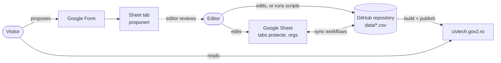
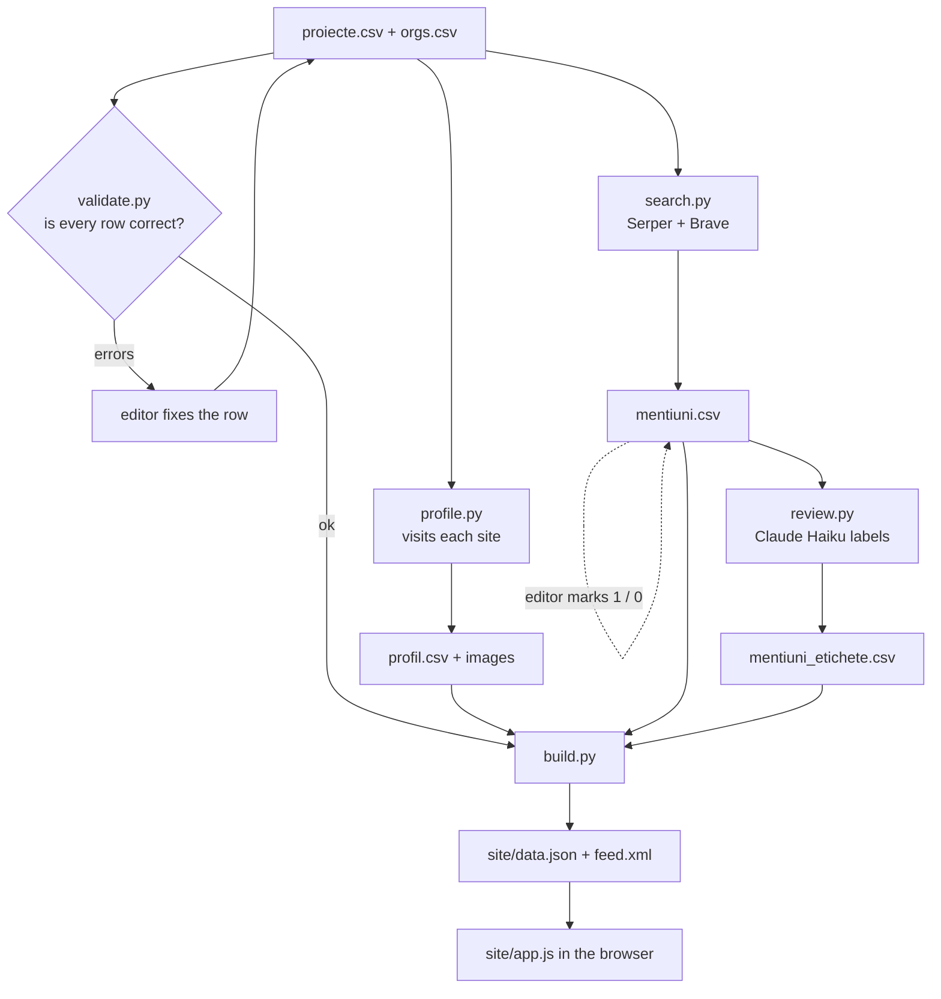
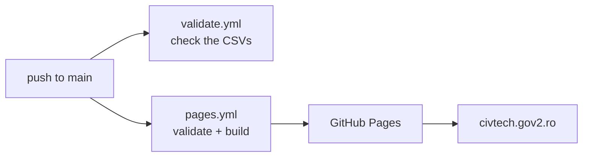
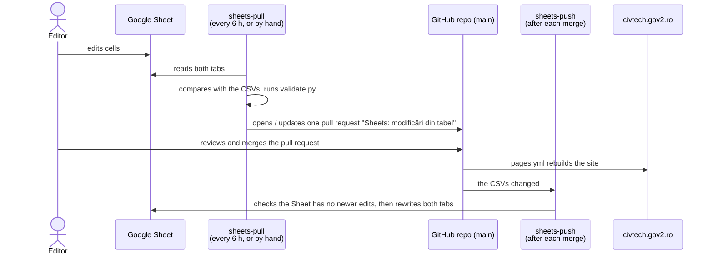
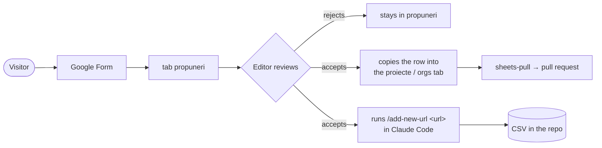
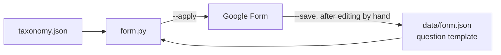

# Architecture

How CivTech România is put together: where the data lives, who changes it, and how a change reaches
the site at [civtech.gov2.ro](https://civtech.gov2.ro/).

## The short version

- The catalogue is **two spreadsheets in the repository**: `data/proiecte.csv` (projects and
  resources) and `data/orgs.csv` (organisations). They are the source of truth.
- A few **scripts** read those files, look at each website, and produce one file for the browser:
  `site/data.json`.
- The **site** is plain HTML and JavaScript. It loads `data.json` and does all filtering and sorting
  in the browser. There is no server and no database.
- **GitHub** stores everything, checks every change, and publishes the site.
- A **Google Sheet** is a second place to edit the two CSVs, and a **Google Form** collects
  proposals from the public. Both connect to the repository through GitHub workflows.



## The data files

| File | Who writes it | What it holds |
| --- | --- | --- |
| `data/proiecte.csv` | the editor (by hand, in the Sheet, or with `/add-new-url`) | projects and resources |
| `data/orgs.csv` | the editor | organisations |
| `data/taxonomy.json` | the editor, rarely | the allowed domains, types, coverage values, keyword rules, link types |
| `data/profil.csv` | `profile.py` | what the profiler saw on each site: status, image, dates, GitHub stats |
| `data/mentiuni.csv` | `search.py` (plus the `editor` column, by hand) | pages elsewhere on the web that mention each entry |
| `data/mentiuni_etichete.csv` | `review.py` | Claude Haiku's labels for those mentions (news, research, independent…) |
| `data/form.json` | `form.py --save` | the template of the Google Form's questions |
| `site/data.json`, `site/feed.xml`, `site/img/` | `build.py`, `profile.py` | what the site shows |

Rule of thumb: a person edits the first three; scripts write the rest.
[DATA-SCHEMA.md](DATA-SCHEMA.md) explains every column. [CONTRIBUTING.md](../CONTRIBUTING.md) tells a
contributor how to fill in a row.

## From CSV to website

The scripts run on the editor's computer, except `validate.py` and `build.py`, which GitHub also runs
on every change.



- **validate.py** checks each row: known domain and type, a valid address, no duplicate slug. GitHub
  stops a change that fails it.
- **profile.py** visits each website. It records whether the site is up, its title and description,
  its image and icon, its age (Wayback Machine, first certificate), its last update, and the GitHub
  repository's stars, issues and commits. It also downloads the favicons of linked sites.
- **search.py** asks two search engines (Serper for Google, and Brave) which other sites mention
  each entry. Rules drop obvious noise (the project's own site, social networks, company
  registries); the editor can override any row.
- **review.py** sends each entry and its mentions to Claude Haiku. Haiku suggests corrections (for a
  person to accept) and labels each mention. It never changes the CSVs.
- **build.py** joins everything into `data.json`: the status to show, the description to use, the
  links, and the relevance score.

## How the site is published



Every push to `main` that touches `data/`, `scripts/` or `site/` rebuilds `data.json` and publishes
`site/`. It takes about a minute. GitHub does **not** run `profile.py` or `search.py`: the editor runs
them locally and commits what they produce.

**One page per entry.** GitHub Pages is static hosting: it has no rewrite rules and ignores
`.htaccess`. So `build.py` writes `site/<kind>/<slug>/index.html` for every entry, with the kind of its tab: `proiect`, `organizatie` or `resursa`. Each page is
`site/index.html` with that entry's title, description, canonical address and share image in `<head>`,
so link previews and search engines see the entry. `app.js` reads the slug from the path and opens
the entry. The old `/?p=<slug>` still opens it, and then moves to the new address. Git ignores these
pages; the Pages workflow builds them.

## Editing in Google Sheets

The Sheet `civtech.gov2.ro` has the tabs `proiecte` and `orgs`, with the same columns as the CSVs.
The repository stays the source of truth: the Sheet is a comfortable place to edit it.

Two GitHub workflows keep them in step, using a Google **service account** (a robot user that has
edit rights on this one Sheet; its key is a GitHub secret).



What protects the data:

- **Nothing reaches `main` without a person.** Sheet edits always arrive as a pull request, with
  the list of changed cells and the `validate.py` result in its text.
- **Sheet edits are never overwritten.** Before `sheets-push` writes, it checks whether the Sheet
  holds edits that the repository does not have yet. If it does, it stops and writes nothing; the
  next `sheets-pull` brings those edits in.
- **Formats stay safe.** Every cell is plain text, so Sheets never turns `1`, dates or slugs into
  numbers. Write list cells without quotes (`vizualizare, baza-de-date`).

The same can be done from the editor's computer, with the key in the repository's `.env`:

```sh
uv run scripts/sheets.py diff    # what differs between the Sheet and the CSVs; changes nothing
uv run scripts/sheets.py pull    # Sheet → CSVs
uv run scripts/sheets.py push    # CSVs → Sheet (refuses if the Sheet has newer edits)
```

## Proposals through the Google Form

The public form is at <https://forms.gle/wswqrm7P4QV25NZx7>, linked from the site's footer. Its answers
go to a third tab of the same Sheet, `propuneri`. The sync never reads or writes that tab.



The Form's questions come from the data model, so the choices always match the taxonomy:



- `form.py --save` reads the Form, as the editor changed it in Google Forms, into `data/form.json`.
- `form.py --apply` rewrites the questions from that template, with the "Domeniu", "Tip",
  "Acoperire" and "Ce propui?" choices refreshed from `taxonomy.json`. It never changes the Form's
  title, settings or its link to the Sheet. Run it after a taxonomy change.
- A question's title is its column name in `propuneri`: rename questions with care.

## Adding an entry with Claude Code

`/add-new-url <address>` (in Claude Code, in this repository) checks for a duplicate, reads the site,
writes the row in the right CSV, then runs `profile.py`, `search.py`, `validate.py` and `build.py`. It
reports where each value came from and does not commit.

## Keys and secrets

| Where | What |
| --- | --- |
| `.env` at the repository root (never committed) | `SERPER_API_KEY`, `BRAVE_API_KEY`, `ANTHROPIC_API_KEY`, `GOOGLE_APPLICATION_CREDENTIALS` (path to the key file, kept outside the repository), `SHEET_ID`, `FORM_ID` |
| GitHub → Settings → Secrets and variables → Actions | secret `GOOGLE_SA_KEY` (the service-account key), variable `SHEET_ID` |

The scripts read `.env` on their own. The service account can edit only what was shared with it:
the Sheet and the Form.

## Known limits

- The Sheet sync compares whole tabs; it does not merge two people's edits to the same cell.
- A proposal does not become a catalogue row by itself: the editor accepts it.
- The profiler and the search run only on the editor's computer, so `profil.csv` and
  `mentiuni.csv` are as fresh as the last local run.

See [BACKLOG.md](BACKLOG.md) for open work and [ACTIVITY.md](ACTIVITY.md) for the history.
