# Taxonomy v2 — complete vocabulary diagrams

Generated from `data/taxonomy-v2/concepte.csv`. Do not edit this file by hand.

This snapshot contains **125 concepts**. Every concept is included below.

Labels and IDs are shown together for editorial review. All concepts remain proposals unless accepted in the source table.

Arrows run from broader to narrower concepts. Related-concept links and external mappings are omitted from these hierarchy views.

A concept with several broader parents can appear in more than one subject diagram.

[Model and UI implications](taxonomy-v2.md#model-diagram) · [Editing guide](../../data/taxonomy-v2/README.md)

Regenerate with `python3 data/taxonomy-v2/export_mermaid.py`.

## Subject hierarchies

### Guvernare și democrație

```mermaid
flowchart TB
    c_subiect_guvernare_democratie["Guvernare și democrație<br/>subiect:guvernare-democratie"]
    c_subiect_administratie_publica["Administrație publică<br/>subiect:administratie-publica"]
    c_subiect_democratie["Democrație<br/>subiect:democratie"]
    c_subiect_alegeri["Alegeri<br/>subiect:alegeri"]
    c_subiect_vot["Vot<br/>subiect:vot"]
    c_subiect_activitate_parlamentara["Activitate parlamentară<br/>subiect:activitate-parlamentara"]
    c_subiect_finantare_politica["Finanțare politică<br/>subiect:finantare-politica"]
    c_subiect_partide_politice["Partide politice<br/>subiect:partide-politice"]
    c_subiect_reprezentanti_alesi["Reprezentanți aleși<br/>subiect:reprezentanti-alesi"]
    c_subiect_integritate_publica["Integritate publică<br/>subiect:integritate-publica"]
    c_subiect_coruptie["Corupție<br/>subiect:coruptie"]
    c_subiect_sondaje["Sondaje de opinie<br/>subiect:sondaje"]
    c_subiect_afaceri_europene["Afaceri europene<br/>subiect:afaceri-europene"]
    c_subiect_statistica["Statistică<br/>subiect:statistica"]
    c_subiect_guvernare_democratie --> c_subiect_administratie_publica
    c_subiect_guvernare_democratie --> c_subiect_democratie
    c_subiect_guvernare_democratie --> c_subiect_alegeri
    c_subiect_guvernare_democratie --> c_subiect_vot
    c_subiect_guvernare_democratie --> c_subiect_activitate_parlamentara
    c_subiect_guvernare_democratie --> c_subiect_finantare_politica
    c_subiect_guvernare_democratie --> c_subiect_partide_politice
    c_subiect_guvernare_democratie --> c_subiect_reprezentanti_alesi
    c_subiect_guvernare_democratie --> c_subiect_integritate_publica
    c_subiect_guvernare_democratie --> c_subiect_coruptie
    c_subiect_guvernare_democratie --> c_subiect_sondaje
    c_subiect_guvernare_democratie --> c_subiect_afaceri_europene
    c_subiect_guvernare_democratie --> c_subiect_statistica
```

### Finanțe publice

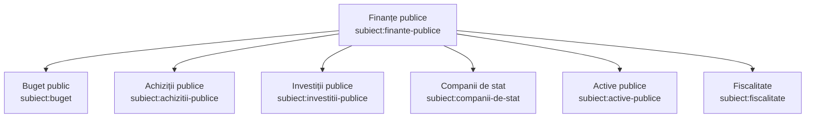

### Drept, justiție și drepturi

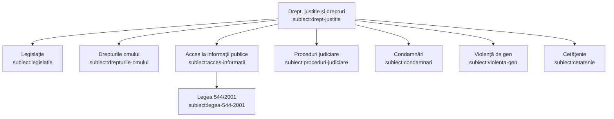

### Media și informare

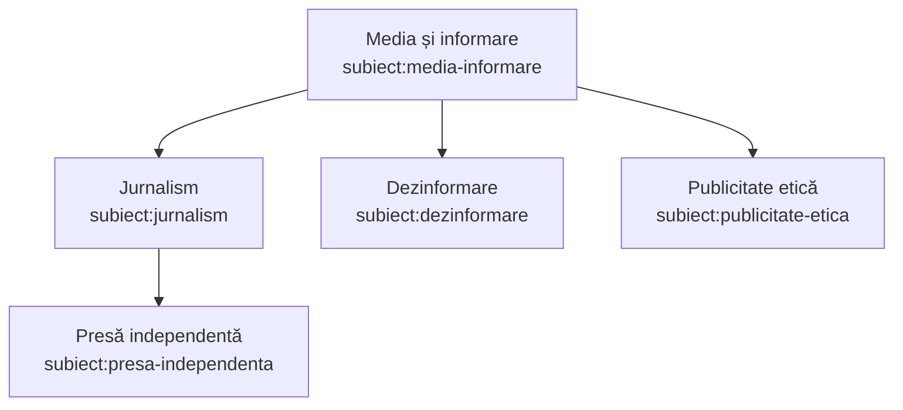

### Mediu și energie

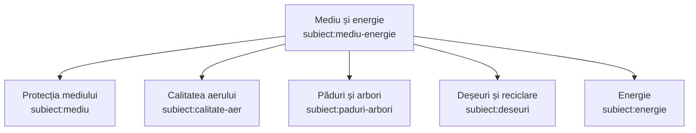

### Sănătate

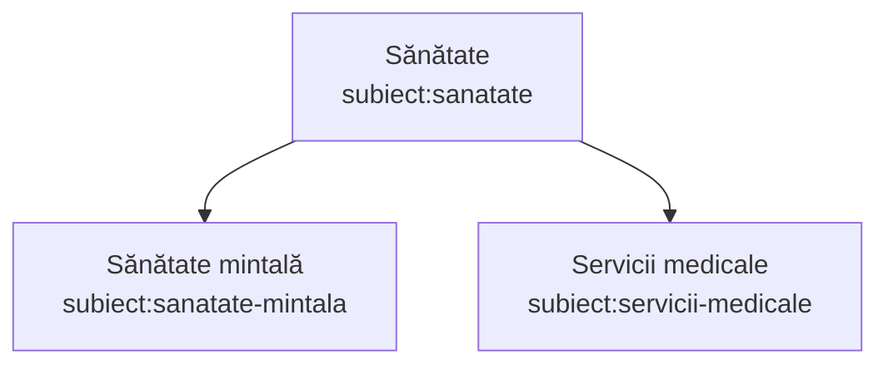

### Educație și cultură

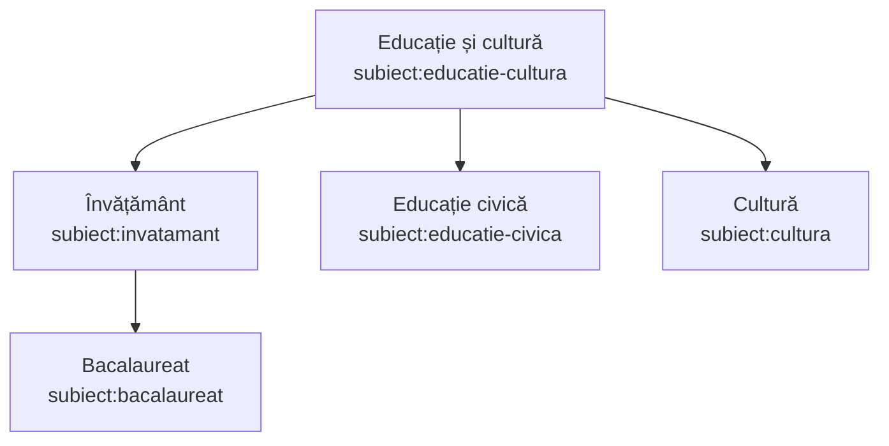

### Comunități și teritoriu

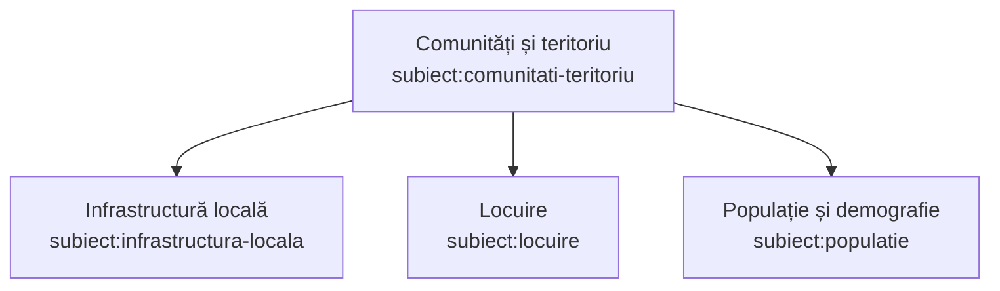

### Economie și muncă

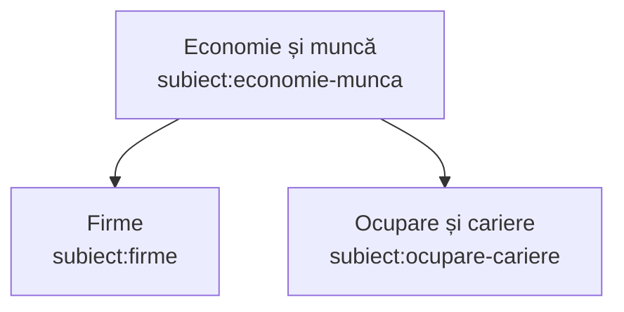

### Societate digitală

```mermaid
flowchart TB
    c_subiect_societate_digitala["Societate digitală<br/>subiect:societate-digitala"]
    c_subiect_digitalizare["Digitalizare<br/>subiect:digitalizare"]
    c_subiect_infrastructura_digitala["Infrastructură digitală<br/>subiect:infrastructura-digitala"]
    c_subiect_securitate_cibernetica["Securitate cibernetică<br/>subiect:securitate-cibernetica"]
    c_subiect_date_personale["Date personale<br/>subiect:date-personale"]
    c_subiect_inteligenta_artificiala["Inteligență artificială ca subiect<br/>subiect:inteligenta-artificiala"]
    c_subiect_tehnologia_informatiei["Tehnologia informației<br/>subiect:tehnologia-informatiei"]
    c_subiect_interfete_programare["Interfețe de programare ca subiect<br/>subiect:interfete-programare"]
    c_subiect_date_deschise["Date deschise<br/>subiect:date-deschise"]
    c_subiect_societate_digitala --> c_subiect_digitalizare
    c_subiect_societate_digitala --> c_subiect_infrastructura_digitala
    c_subiect_societate_digitala --> c_subiect_securitate_cibernetica
    c_subiect_societate_digitala --> c_subiect_date_personale
    c_subiect_societate_digitala --> c_subiect_inteligenta_artificiala
    c_subiect_societate_digitala --> c_subiect_tehnologia_informatiei
    c_subiect_societate_digitala --> c_subiect_interfete_programare
    c_subiect_societate_digitala --> c_subiect_date_deschise
```

### Societate civilă

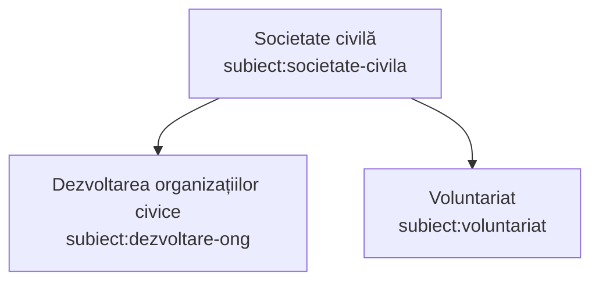

### Protecție socială și incluziune

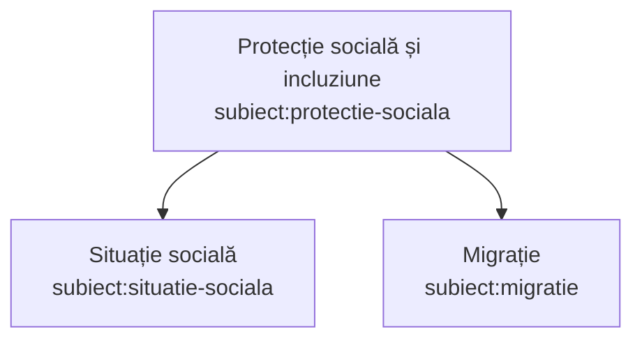

### Securitate și reziliență

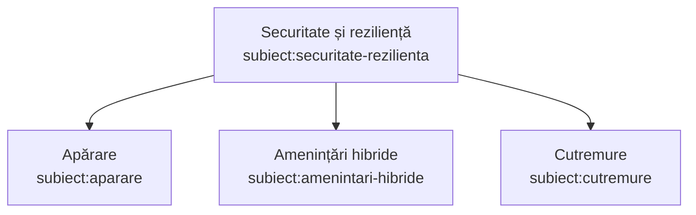

## Independent facets

The scheme node groups its concepts; it is not an additional concept or a broader-topic assertion.

### Scopuri civice

```mermaid
flowchart TB
    scheme["Scopuri civice"]
    c_scop_transparenta["Transparență<br/>scop:transparenta"]
    scheme --> c_scop_transparenta
    c_scop_responsabilizare["Responsabilizare publică<br/>scop:responsabilizare"]
    scheme --> c_scop_responsabilizare
    c_scop_participare["Participare civică<br/>scop:participare"]
    scheme --> c_scop_participare
    c_scop_acces_servicii["Acces la servicii<br/>scop:acces-servicii"]
    scheme --> c_scop_acces_servicii
    c_scop_informare["Informare și înțelegere<br/>scop:informare"]
    scheme --> c_scop_informare
    c_scop_educatie["Învățare<br/>scop:educatie"]
    scheme --> c_scop_educatie
    c_scop_sprijin_organizatii["Sprijin pentru organizații civice<br/>scop:sprijin-organizatii"]
    scheme --> c_scop_sprijin_organizatii
    c_scop_aparare_drepturi["Apărarea drepturilor<br/>scop:aparare-drepturi"]
    scheme --> c_scop_aparare_drepturi
    c_scop_anticoruptie["Prevenirea și combaterea corupției<br/>scop:anticoruptie"]
    scheme --> c_scop_anticoruptie
    c_scop_pregatire_riscuri["Pregătire pentru riscuri<br/>scop:pregatire-riscuri"]
    scheme --> c_scop_pregatire_riscuri
```

### Funcționalități și activități

```mermaid
flowchart TB
    scheme["Funcționalități și activități"]
    c_functie_cautare["Caută și consultă<br/>functie:cautare"]
    scheme --> c_functie_cautare
    c_functie_comparare["Compară<br/>functie:comparare"]
    scheme --> c_functie_comparare
    c_functie_monitorizare["Monitorizează<br/>functie:monitorizare"]
    scheme --> c_functie_monitorizare
    c_functie_sesizare["Trimite sau urmărește o sesizare<br/>functie:sesizare"]
    scheme --> c_functie_sesizare
    c_functie_cerere_informatii["Solicită informații publice<br/>functie:cerere-informatii"]
    scheme --> c_functie_cerere_informatii
    c_functie_generare_documente["Completează sau generează documente<br/>functie:generare-documente"]
    scheme --> c_functie_generare_documente
    c_functie_verificare["Verifică informații<br/>functie:verificare"]
    scheme --> c_functie_verificare
    c_functie_verificare_fapte["Verifică fapte<br/>functie:verificare-fapte"]
    scheme --> c_functie_verificare_fapte
    c_functie_analiza["Analizează date<br/>functie:analiza"]
    scheme --> c_functie_analiza
    c_functie_invatare["Învață sau exersează<br/>functie:invatare"]
    scheme --> c_functie_invatare
    c_functie_donatii["Donează sau redirecționează fonduri<br/>functie:donatii"]
    scheme --> c_functie_donatii
    c_functie_petitii["Semnează sau organizează petiții<br/>functie:petitii"]
    scheme --> c_functie_petitii
    c_functie_advocacy["Organizează advocacy<br/>functie:advocacy"]
    scheme --> c_functie_advocacy
    c_functie_mentorat["Primește mentorat<br/>functie:mentorat"]
    scheme --> c_functie_mentorat
    c_functie_alerte["Primește alerte<br/>functie:alerte"]
    scheme --> c_functie_alerte
```

### Formate

```mermaid
flowchart TB
    scheme["Formate"]
    c_format_harta["Hartă<br/>format:harta"]
    scheme --> c_format_harta
    c_format_vizualizare["Vizualizare de date<br/>format:vizualizare"]
    scheme --> c_format_vizualizare
    c_format_registru["Registru sau bază de date<br/>format:registru"]
    scheme --> c_format_registru
    c_format_ghid["Ghid<br/>format:ghid"]
    scheme --> c_format_ghid
    c_format_colectie["Catalog sau colecție<br/>format:colectie"]
    scheme --> c_format_colectie
    c_format_joc_test["Joc sau test<br/>format:joc-test"]
    scheme --> c_format_joc_test
    c_format_curs["Curs sau atelier<br/>format:curs"]
    scheme --> c_format_curs
    c_format_articol["Articol<br/>format:articol"]
    scheme --> c_format_articol
    c_format_raport["Raport sau cercetare<br/>format:raport"]
    scheme --> c_format_raport
    c_format_formular["Formular<br/>format:formular"]
    scheme --> c_format_formular
    c_format_api["API oferit<br/>format:api"]
    scheme --> c_format_api
    c_format_set_date["Set de date oferit<br/>format:set-date"]
    scheme --> c_format_set_date
```

### Tehnologii

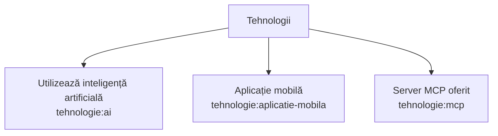

### Instituții vizate

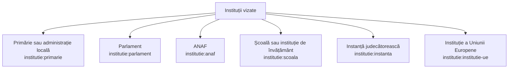

### Tipuri de organizație

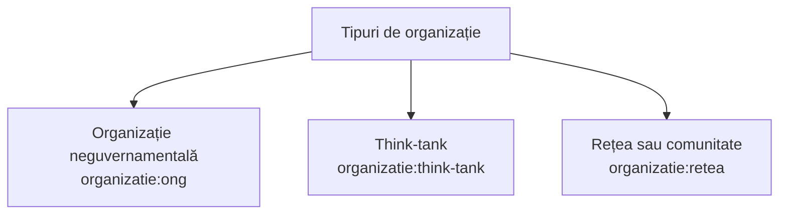

### Maturitate

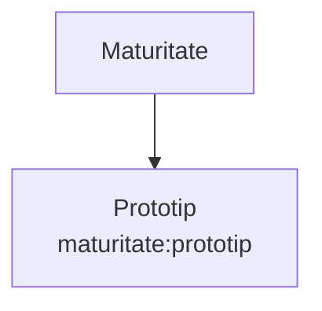

