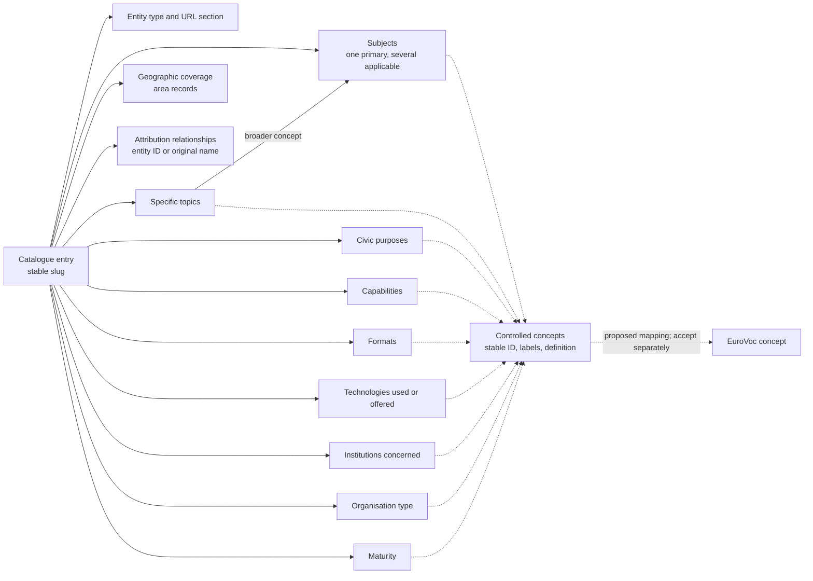
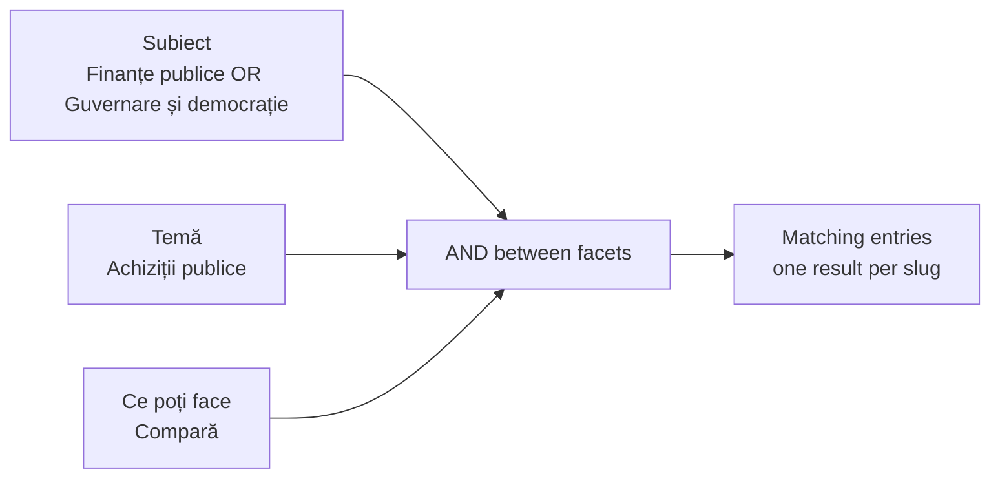

# Taxonomy v2 — review copy and migration specification

## Status and boundaries

Status: **core slices 1–4 implemented as a local preview; entry classifications remain proposed**, dated 2026-10-19.
Current package version: `2.0.0-draft.2`. The production site still reads the v1 source in `data/`.
These are proposal schema versions, not project releases.

Implemented: the draft.2 package and its checks, the integration copy `data/taxonomy-v2/integrare/`,
schema-aware loaders, `scripts/validate.py --data-dir`, `scripts/build.py --data-dir --site-dir --allow-draft`,
and the v2 browser code in `site-v2/`. See [Implementation notes](#implementation-notes-2026-10-19).
Enrichment, Sheets, Forms, CI and the source cutover remain later slices.

The deliverable is `data/taxonomy-v2/`. It contains all 122 current catalogue entries.
The original CSVs, taxonomy, site assets, and production scripts remain unchanged.
No Google file, workflow, deployment, profiler, paid search, or model review was run.

The package uses CSV and JSON. It introduces no database server, dependency, or RDF store.
It follows SKOS concepts, but it is not an RDF serialization or an ISO conformity claim.
The official EuroVoc response verifies target identifiers and labels, not the proposed semantic equivalences.

All classifications are `propus`. The owner decides what to accept.
Do not publish the package merely because structural validation passes.

Start a fresh implementation session with [handoff-taxonomy-v2.md](../briefs/handoff-taxonomy-v2.md).
The model-neutral [automated classification prompt](../prompts/taxonomy-v2-classifier.md) defines a separate inference experiment.
Writing that prompt does not run the experiment or choose a paid provider.

## Agreed implementation revision

The following decisions supersede draft.1 wherever the current files still differ.
Implement the data-package revision first, then adapt its consumers.
Do not tell a classifier that four maturity concepts exist until the vocabulary actually contains them.

### Maturity and other attributes

`maturitate` is optional and single-valued. Add the three missing concepts to `concepte.csv`:

| ID | Romanian label | Definition |
| --- | --- | --- |
| `maturitate:experiment` | Experiment | Explores an idea or approach; practical use is not established. |
| `maturitate:prototip` | Prototip | Demonstrates intended functionality. Preserve this existing identifier. |
| `maturitate:pilot` | Pilot | Used in a limited real-world deployment or trial. |
| `maturitate:operational` | Operațional | Offered for ordinary use by its intended audience. |

Require a declaration or concrete evidence. A working website alone is insufficient.
An entry cannot hold several stages as a development history.
Publications and organisations do not receive software maturity merely because their websites work.
Do not backfill the new stages automatically during the structural migration.

`stabil` concerns reliability; `consacrat` concerns adoption or reputation.
These need separate definitions and evidence before becoming attributes.
`noutate` is a time-based presentation property, ideally derived from a confirmed launch date.
Availability, maintenance activity, and project closure are also distinct from maturity.
This revision does not add these other attributes speculatively.

The package already uses scheme-qualified concept IDs, such as `functie:comparare`.
Keep separate facet columns. Do not collapse them into an undifferentiated attributes cell.
A future live assignment table can use `slug`, `camp`, and `concept` rows if needed.
The historical `atribuiri-initiale.csv` must not silently become that live table.

### Cardinality

| Field group | Cardinality |
| --- | --- |
| `subiect_principal` | Exactly one root for a complete catalogue entry |
| `subiecte` | One or more roots, including the primary root |
| `teme`, `scopuri`, `functionalitati`, `formate` | Zero or more IDs |
| `tehnologii`, `institutii_vizate`, `tip_organizatie`, `arii_acoperite` | Zero or more IDs |
| `maturitate` | Zero or one concept ID |
| Entity type, URL section, coverage level, confidence, and classification state | One code each |
| Manual availability override and preserved civic-tech flag | Zero or one code each |

CSV list cells use `|`; maturity must reject a pipe-separated pair.
In the next editorial JSON export, maturity is a string or `null`, not an array.
The public browser payload's `maturity` follows the same scalar contract.
Optional unknowns stay empty in CSV and null for scalar values in JSON.
The explicit coverage code `necunoscut` remains available.

The model-output schema permits a null primary subject for an abstention.
Such a result is an incomplete proposal, not a structurally complete canonical catalogue entry.
Do not invent a default subject to import it.

### Editable lists and configuration

Use these authoritative CSV tables in draft.2:

| File | Exact columns | Purpose |
| --- | --- | --- |
| `valori.csv` | `lista,cod,eticheta_ro,eticheta_en,definitie_ro,statut,ordine` | Named code lists, with one value per row |
| `roluri-linkuri.csv` | `id,eticheta_ro,eticheta_en,definitie_ro,statut,ordine` | Link roles, preserving existing role IDs |
| `gazde-linkuri.csv` | `gazda,rol` | Host-to-role lookup, with one host per row |

Within `valori.csv`, `(lista,cod)` is unique. Codes are non-empty strings; `ordine` is an integer within its list.
Use `propus`, `acceptat`, or `retras` for a code row's status. The structural contract defines these lifecycle tokens.
Absence is a field rule, not a blank-code row.
For example, the optional manual-state field allows blank plus the listed codes `arhivat` and `offline`.
Likewise, the preserved civic-tech flag allows blank plus codes `0` and `1`.

Move all current `schema.json` enum values and relationship predicates into named code lists.
Also centralise the validator's editable lists for concept status, relation review status, review-item status,
priority, area type, and mapping relation/status. Avoid leaving equivalent editable lists hardcoded in Python.
Protocol tokens in the model-output JSON Schema are a separate versioned interface, not a second source for catalogue labels.
The runner must check or compile its allowed catalogue code values against the frozen CSV lists before a run.

Use explicit list names in structural field rules. Suggested names are `tip_entitate`, `sectiune_url`,
`nivel_acoperire`, `clasificare_stare`, `incredere`, `stare_manual`, `civictech_original`, `concept_statut`,
`relatie_predicat`, `relatie_stare`, `revizuire_stare`, `prioritate`, `tip_arie`, `mapare_relatie`, and `mapare_stare`.
Map each physical column to its named list in `schema.json`, even when the column is called `stare` or `statut`.

The JSON file retains column definitions, requiredness, types, cardinality, scheme restrictions,
and references to named code lists. Remove independently maintained duplicate enum arrays.
For example, a field-rule representation may contain:

```json
{
  "field_rules": {
    "maturitate": {"kind": "concept", "scheme": "maturitate", "min_items": 0, "max_items": 1},
    "subiecte": {"kind": "concept", "scheme": "subiect", "min_items": 1, "max_items": null},
    "tip_entitate": {"kind": "code", "list": "tip_entitate", "required": true}
  }
}
```

Here `max_items=null` means unbounded. This is a local structural contract, not a JSON Schema standard keyword set.
The implementation can choose an equivalent representation if it enforces these rules and documents it.

Move section labels and order into the `sectiune_url` code list.
Remove `sectiuni` and `roluri_linkuri` as independently edited sources in `setari.json`.
Keep reporting addresses and genuine site settings there.
The generated JSON may assemble code-list labels and roles into the existing convenient settings structure.
Generated copies must not become a second editorial source.

Keep link tokens such as `donatii:https://...` compatible. Role IDs remain `donatii`, `github`, and the existing keys.
Validate every host's role reference and preserve the current host lookup behaviour during extraction to CSV.
Do not add wildcard or subdomain inference as an incidental migration change.
Adding a new routing code still requires matching route support; editable CSV is not a guarantee of automatic implementation.

### Vocabulary scope

The vocabulary supports existing entries and plausible future use. It is not an exhaustive universal catalogue.
At draft.1, 119 of 125 concepts are assigned. Six are unused: housing, information technology,
volunteering, anti-corruption purpose, an offered API, and an offered MCP server.
Adding three maturity concepts produces 128 concepts before any later vocabulary proposals.
Hide unused concepts in public filters. A meaningful single-entry concept is allowed.
New terms require a definition and a clear distinction from existing terms.
Automated concept proposals remain separate from assignments until accepted into a versioned vocabulary.

### Automated inference experiment

The owner wants to test an initially fully automated classification pass.
This supersedes a manual-first experiment sequence; human review is not required before each model request.
It does not convert model confidence or successful validation into editorial acceptance.

Use the [classifier prompt](../prompts/taxonomy-v2-classifier.md) and its adjacent JSON Schema.
Run against original evidence, withholding the manually proposed v2 assignments until evaluation.
Keep `local_only` and `retrieved_evidence` results in separate run directories.
Do not overwrite the existing proposal or production data.
All imported candidates remain `propus`, and incomplete records stay in the raw output and review queue.
The current request authorises prompt preparation; no model call, provider selection, or paid inference run has been made.

## Model diagram

The entry has several independent facets. A concept belongs to one vocabulary scheme.
The subject scheme contains both broad subjects and narrower topics.
Geographic areas and attribution relationships are separate records.



The complete vocabulary is drawn in [taxonomy-v2-vocabulary.md](taxonomy-v2-vocabulary.md).
It contains all 125 current concepts, divided into readable subject and facet diagrams.
Generate it again after editing the concept table:

```sh
python3 data/taxonomy-v2/export_mermaid.py
```

The model diagram is explanatory. The vocabulary diagrams are generated from `concepte.csv`.
Neither is a proposed graph interface for public visitors.

## Files and editing workflow

Start with [the package README](../../data/taxonomy-v2/README.md).

| File | Ownership |
| --- | --- |
| `intrari.csv` | Editable catalogue. One row per existing slug; all three site sections share one schema. |
| `concepte.csv` | Editable controlled vocabulary; canonical source for labels and concept relationships. |
| `arii.csv` | Editable geographic areas. Local identifiers do not imply SIRUTA or NUTS mappings. |
| `relatii.csv` | Editable entity relationships, with the original attribution and its unresolved role. |
| `mapari-externe.csv` | Editable, proposed EuroVoc mappings; accept them independently from entry classifications. |
| `revizuire.csv` | Editable review queue, including the owner's decisions. |
| `setari.json` | Reporting addresses only. Sections and link roles moved to CSV in draft.2. |
| `schema.json` | Versioned structural contract. draft.2 replaces duplicate enums with named CSV code-list references and explicit cardinality. |
| `valori.csv`, `roluri-linkuri.csv`, `gazde-linkuri.csv` | Authoritative draft.2 code lists, link roles, and host lookup. |
| `versiuni.json` | Version history of the package; the last entry matches `schema.json`. |
| `integrare/` | Overlay of the sealed run's candidate, with the evaluation's corrections. See its `pachet.json`. |
| `catalogue.json` | Generated export of the editable tables, vocabulary, areas, relations, and settings. |
| `observatii/` | Working copies of the profile and mentions, initially identical to the source snapshots. |
| `source/` | Immutable snapshots of every top-level CSV/JSON file in the original `data/`. |
| `reference/` | Official EuroVoc query, response, and methodological sources. |
| `atribuiri-initiale.csv` | Historical record of the initial assignments, evidence, confidence basis, and date. |
| `corespondente-v1.csv` | Historical crosswalk for every used old category, type, and raw keyword, plus old aliases and exclusions. |
| `manifest.json` | Initial counts, scope, and SHA-256 hashes of the source and official reference snapshots. |

`international.csv` remains a seed, copied only to `source/`. It does not create new catalogue entries.
Images remain in the existing `site/img/`. Observation rows with deleted slugs are preserved but do not create entries.

Manual review:

1. Resolve high-priority items in `revizuire.csv` first.
2. Edit `intrari.csv`, using identifiers from `concepte.csv` and `arii.csv`.
3. Record each decision in the review queue. Mark it `acceptat`, `respins`, or `amanat`.
4. Confirm every facet before setting an entry's `clasificare_stare` to `acceptat`.
5. Review relationship roles and external mappings separately.
6. Validate the edited package and regenerate the JSON export.

```sh
# From the repository root; no network or production writes.
python3 data/taxonomy-v2/validate.py --export

# Before manual edits: also verify the initial copy against the original snapshots.
python3 data/taxonomy-v2/validate.py --baseline --export
```

The baseline has 122 entries, 125 concepts, 13 top-level subjects, 86 attributions,
822 initial concept assignments, 22 proposed EuroVoc mappings, and 66 specific review items.
Every entry still needs review, even when it has no specific queue item.

The initial evidence ledger does not change when an editor changes a classification.
For implementation, add an append-only editorial change log rather than rewriting that migration history.

## Data model and invariants

### Entry schema

Keep CSV headers and order as listed in `schema.json`. List cells use `|`.
IDs contain no display labels; the vocabulary supplies Romanian and English labels.
Empty means unknown or not applicable. Unknown is not a negative assertion.

| Column or group | Meaning and constraints |
| --- | --- |
| `slug` | Stable catalogue identity and observation join key. Unique across all entity types. |
| `tip_entitate` | `proiect`, `organizatie`, `resursa`, `publicatie`, `set-date`, or `campanie`. Describes the catalogued entity. |
| `sectiune_url` | `proiect`, `organizatie`, or `resursa`. Preserve current routes independently of entity type. |
| `nume`, `descriere_scurta`, `descriere`, `url`, `linkuri` | Original text and links, copied without editorial rewriting. |
| `subiect_principal` | One top-level subject. It must occur in `subiecte`. Used for the grouped default view. |
| `subiecte` | One or more top-level subjects, deduplicated. A project can appear under several subject filters. |
| `teme` | Narrower subject concepts. Include every applicable root ancestor in `subiecte`. |
| `scopuri` | Civic purposes. These are not subject synonyms. |
| `functionalitati` | Actions the user or organisation can perform. The detail panel must distinguish an organisation's activity from a tool's feature. |
| `formate` | Offered content or presentation forms. Multiple forms are allowed. |
| `tehnologii` | Technologies explicitly used or offered. A subject mention is insufficient. |
| `institutii_vizate` | Institution types or named institutions discussed, served, or used as data sources. Does not assert ownership or partnership. |
| `tip_organizatie` | Organisation categories; empty for other entity types. Not a legal registration check. |
| `maturitate` | Zero or one evidenced stage: experiment, prototype, pilot, or operational. Independent from availability and reliability. |
| `nivel_acoperire` | `national`, `local`, `international`, or `necunoscut`. Do not silently default unknown to national. |
| `arii_acoperite` | Area IDs. A national project with local records can still cover `tara:RO`. |
| `localitate_originala` | Original city text. Preserved without interpreting an organisation's address as its service area. |
| `autor_original`, `contact` | Preserved attribution text and contact. Relations hold the structured attribution. |
| `civictech_original` | Original `0`, `1`, or blank, retained as legacy editorial data. Not a new certification. |
| `stare`, `nota` | Original manual availability override and internal note. `nota` must remain private in the public build. |
| `clasificare_stare` | `propus`, `acceptat`, or `de-revizuit`. This controls editorial readiness, not HTTP status. |
| `incredere` | `mica`, `medie`, or `mare`. Initial values reflect source completeness, not a calibrated probability. |
| `sursa_fisier`, `sursa_rand` | Source snapshot and CSV record number, with the header as record 1. This is not a physical line number for multiline records. |
| `nota_clasificare` | Internal classification note; keep it out of the public JSON. |

Initial `tip_entitate` preserves existing project/resource distinctions except for the clearly described individual investigation
`piratii-digitali-ai-kremlinului`, proposed as `publicatie`. Its URL section remains `resursa`.
Do not reclassify a whole project as a publication merely because it offers guides.
Do not create a dataset entity unless an identifiable dataset is being catalogued separately.

### Vocabulary schema

`concepte.csv` has one concept per row:

- `id`: stable, scheme-qualified identifier, for example `subiect:achizitii-publice`.
- `schema`: `subiect`, `scop`, `functie`, `format`, `tehnologie`, `institutie`, `maturitate`, or `organizatie`.
- `eticheta_ro`, `eticheta_en`: one preferred label per language.
- `alternative_ro`: alternative search labels, separated by `|`.
- `definitie_ro`: scope and meaning, including important exclusions.
- `mai_larg`: broader concept IDs. The initial hierarchy has one parent per child; the list format permits multiple parents.
- `asociate`: related concept IDs. Association is not synonymy or an assignment rule.
- `statut`: `propus`, `acceptat`, or `retras`.

Broader links stay within a scheme and form an acyclic hierarchy.
Specific subject concepts share the `subiect` scheme with their roots.
The thirteen roots are local browsing groups, not official EuroVoc divisions.
Hide unused groups in the public UI. Do not display an empty universal category tree.

The subject hierarchy includes useful distinctions such as:

```text
Finanțe publice
  Achiziții publice
  Buget public
  Investiții publice

Drept, justiție și drepturi
  Acces la informații publice
    Legea 544/2001

Educație și cultură
  Învățământ
    Bacalaureat
  Educație civică
```

Do not reuse a retired ID for another meaning. A label correction does not require an ID change.
Add a new concept when its scope differs. Record replacements explicitly during a later vocabulary revision.

### Relationships and geography

`relatii.csv` stores a subject slug, predicate, and either an object slug or an object literal.
Exactly one object form must be present. Both ID endpoints must exist in the catalogue.
Literal objects preserve people and organisations that do not have their own entry.
Do not create entities by fuzzy name matching.

All 86 initial relations use `atribuit_in_sursa` and `stare=rol_neconfirmat`.
The old `autor` field does not distinguish creators, publishers, funders, and maintainers.
Future verified predicates may use `creat_de`, `mentinut_de`, `publicat_de`, `finantat_de`, `parte_din`, `ofera`, or `foloseste`.
Typed roles require evidence and editorial acceptance. `ofera`, `foloseste`, and `parte_din` should target entity IDs, not unnamed literals.

`arii.csv` separates countries, regions, counties, and localities. Parent links are geographic containment.
The initial `RO` is a country code; local identifiers are not claimed as official administrative codes.
Do not infer EU membership from geographic containment. The EU and Europe are separate regional concepts.
An organisation's location is not automatically its area of activity.

## Classification policy

Classify the actual entry, not everything mentioned on its website or by its publisher.
Use the preserved curated description first. Treat existing names and tags as weaker evidence.
This pass did not fetch individual project websites or import profiler descriptions into the editorial text.

The proposal intentionally separates:

- Public finance as a subject, transparency as a purpose, and comparison as a capability.
- Corruption as a phenomenon, anti-corruption as a purpose, and convictions as a legal topic.
- A subject about AI from a technology claim that the entry uses AI.
- A catalogue about API/MCP services from an API or MCP server offered by that catalogue.
- A municipality as an institution from a geographic service area.
- A prototype from an offline or archived website.
- A publication's format from the identity of its publisher or underlying project.

The old aliases `educație → educație-civică`, `condamnări → anticorupție`, and `corupție → anticorupție` must not survive as synonym rules.
Keep these concepts separate. Use broader or related links where appropriate.
The crosswalk preserves unused old aliases too, so a future import cannot silently repeat the old transformations.

Do not delete tags merely because they are absent from a controlled vocabulary.
Preserve the original term in the import record and send it to review.
Candidate concepts separated by `|` in the crosswalk are alternatives that need context, not an instruction to apply all of them.

Example: `ce-cumpara-primaria`

```json
{
  "slug": "ce-cumpara-primaria",
  "tip_entitate": "proiect",
  "sectiune_url": "proiect",
  "subiect_principal": "subiect:finante-publice",
  "subiecte": ["subiect:finante-publice"],
  "teme": ["subiect:achizitii-publice"],
  "scopuri": ["scop:transparenta", "scop:responsabilizare"],
  "functionalitati": ["functie:cautare", "functie:comparare"],
  "formate": ["format:vizualizare"],
  "institutii_vizate": ["institutie:primarie"],
  "nivel_acoperire": "national",
  "arii_acoperite": ["tara:RO"],
  "clasificare_stare": "propus"
}
```

The generic `date` and `servicii` domains were unpacked from descriptions rather than assigned to new universal buckets.
`calitate-aer-radauti` is now discoverable under environment while retaining its local coverage.
`monitor-cetatenie` concerns citizenship. `centrul-pentru-cariere` concerns employment.
`europescope` and `semnal-razboiul-hibrid` have proposed international coverage, with review items for confirmation.
The two national organisations with a city value retain that city as uninterpreted original text.

Sparse entries retain low confidence. `incentru`, for example, receives a provisional broad classification from the old category.
The proposal does not pretend that this establishes its actual subject or functionality.
CRPE's agricultural and rural-development work is noted for review; the small current vocabulary does not cover every possible sector.

## Standards and external mappings

Use [EuroVoc](https://op.europa.eu/en/web/eu-vocabularies/dataset/-/resource?uri=http%3A%2F%2Fpublications.europa.eu%2Fresource%2Fdataset%2Feurovoc)
as a subject reference. Follow [SKOS](https://www.w3.org/TR/skos-primer/) for vocabulary representation principles.
[ISO 25964](https://www.niso.org/standards-committees/iso-25964) informs vocabulary governance and interoperability.
These are three different roles; none defines whether a catalogue entry is civic tech.

The official SPARQL endpoint returned 22 of the 30 requested English labels.
The stored response supplies each returned concept's URI, English preferred label, and Romanian preferred label.
No missing identifier was invented. `manifest.json` hashes both the query and response.
See [reference/SOURCES.md](../../data/taxonomy-v2/reference/SOURCES.md).

`mapari-externe.csv` uses `relatie=closeMatch` and `stare_mapare=propus` for every initial mapping.
That is a proposed relationship, not an accepted assertion.
Some local scopes are deliberately narrower than the official labels, such as public information versus information generally.
The editor may accept a close match, change its relation, or reject it.

Future RDF export rules:

1. Give local concepts persistent HTTPS URIs after choosing and publishing a durable namespace.
2. Export labels, definitions, concept schemes, and accepted broader/related relationships using SKOS.
3. Export external mapping triples only for `stare_mapare=acceptat`.
4. Preserve the literal official target URI; do not rewrite it based on the browsing page's address.
5. Do not convert `closeMatch` to `exactMatch` on the basis of similar labels.
6. Do not infer a project classification from an external mapping without a separate local assignment.

The package does not assert COFOG or EU Data Theme mappings.
COFOG can be added for public expenditure functions later. EU Data Theme can support dataset exports later.
Neither should become an automatic replacement for civic-purpose or capability facets.

## Script and interface changes

The shared loading, validation, build, and browser changes below are **implemented for the preview**.
Profiling, search, model review, Sheets, Forms, and CI remain **specified, not implemented**.

### Shared loading and file ownership

In `scripts/common.py`:

- Add schema-version-aware `load_catalogue(data_dir)` and `load_vocabulary(data_dir)` functions.
- Add canonical column lists for entries, concepts, relations, areas, mappings, and review records.
- Keep the v1 `PROIECTE_COLS` and `ORGS_COLS` while the old Sheet integration remains active.
- Add `split_ids` for pipe-separated IDs. Do not reuse the comma-separated `split_tip` parser for v2 cells.
- Read concepts from `concepte.csv`, code lists from `valori.csv`, and roles/host lookup from their dedicated CSVs.
- Read reporting addresses and genuine site settings from `setari.json`. Assemble derived settings for consumers without duplicating editorial sources.
- Replace the import-time assumption that `_TAX` always has `domenii`, `tipuri`, and `fel`.
- Return common fields such as `slug`, `nume`, `url`, `linkuri`, `stare`, and the resolved attribution relations.
- Use `sectiune_url` for the current three route kinds. Do not derive URLs from `tip_entitate`.
- For v2, locate generated CSVs in `observatii/`. Never write into `source/` or `reference/`.
- Pass an explicit data root through loaders. Keep the existing production root as the default until cutover.

Keep profiler fields separate from editorial classification. An enrichment refresh must never overwrite accepted facets.
Preserve fields owned by other enrichment stages when replacing an HTTP profile row.

Proposed preview options for the implementation:

```sh
python3 scripts/validate.py --data-dir data/taxonomy-v2/integrare
python3 scripts/build.py --data-dir data/taxonomy-v2/integrare --site-dir /tmp/civtech-v2-preview --allow-draft
```

`--site-dir` must control every output, page deletion, asset stamp, and image reference.
Copy the source template and assets into the preview destination before changing them.
A preview must not rewrite `site/index.html` or delete production entry directories.
The explicit `--allow-draft` option is for preview only; the public build must not silently publish proposed classifications.

### Validation

In `scripts/validate.py`, retain the v1 checks and add a v2 branch:

- Require unique slugs across all entity types and valid reference endpoints.
- Check exact CSV headers, row widths, list delimiters, enums, and concept schemes.
- Detect broader-concept and geographic-containment cycles.
- Require one primary root, include it in `subiecte`, and include each topic's root ancestors.
- Check that `tip_organizatie` occurs only on organisations.
- Require locality or county references for local coverage. Preserve unknown coverage as unknown.
- Keep manual state, maturity, classification readiness, and confidence distinct.
- Enforce at most one maturity concept and use scalar maturity in both editorial and public JSON.
- Resolve allowed code values through CSV code-list references rather than copied enum arrays.
- Reject active assignments to retired concepts.
- Require evidence for accepted typed relationship roles.
- Check external mapping targets and review states without making network calls during CI.
- For publication, fail when an entry classification is unaccepted or it has an unresolved high-priority review item.
- Keep internal notes, source ledger details, and reviewer comments out of public output.

`scripts/taxonomy_v2.py` implements these checks for both validators. They permit proposals for manual review.
`--publication` adds the gate; `build.py` applies it to a v2 root unless `--allow-draft` is given.

### Build and exported browser data

In `scripts/build.py`:

| Function or area | Required change |
| --- | --- |
| `main()` | Load the unified entry table and independent facets. Join observations by unchanged slug. |
| `keywords()` | Replace destructive alias/drop rules with vocabulary ID resolution. Keep unresolved imports in the review queue. |
| `authors()` | Resolve `relatii.csv`. Display unresolved attributions neutrally; do not label them all maintainers. |
| `score()` | Replace the old keyword-presence completeness term with a bounded editorial-completeness signal. More assigned concepts must not produce a higher score. |
| `entry_pages()` | Use `sectiune_url` and unchanged slug. Keep image/profile joins and path depth correct. |
| `archive_pages()` | Group by primary subject. Show secondary subjects without duplicating the default archive entry. |
| `llms_txt()` | Replace old `domenii` and `fel` grouping with primary subject, entity type, and format as appropriate. |
| `feed()` | Keep its current eligibility and date behaviour during this migration. The separate date-methodology defect remains in the audit backlog. |
| `stamp_assets()` | Use the selected output directory. A preview must not stamp the production template. |

The new browser payload should carry a `schemaVersion` and these properties:

| Browser field | v2 source |
| --- | --- |
| `kind` | `sectiune_url`; preserves the current three tabs and routes |
| `entityType` | `tip_entitate` |
| `primarySubject` | `subiect_principal` |
| `subjects`, `topics` | `subiecte`, `teme` as arrays |
| `purposes`, `capabilities`, `formats`, `technologies` | Corresponding facet arrays |
| `institutions`, `organisationTypes` | Corresponding facet arrays |
| `maturity` | One maturity ID or null |
| `coverageLevel`, `areas` | `nivel_acoperire`, `arii_acoperite` |
| `attributions` | Resolved relations, preserving unresolved roles and literal names |
| `legacy` | Original category, type, and keywords retained only to interpret old bookmarked filters |
| `row` and reporting configuration | Row in the new entry tab, not the old split-table row |

Continue using current public text, link, profile, and image fields where their meaning is unchanged.
Do not copy all columns from `intrari.csv` into public output.
For example, exclude `nota`, `nota_clasificare`, source record metadata, and review decisions.
The draft `catalogue.json` is a complete editorial export and is not the proposed public `site/data.json`.

### Browser filtering and search

In `site/app.js`, update `DEFAULTS`, `FILTERS`, `readURL`, `filterQuery`, `matches`, `countBy`,
`facetsHTML`, `renderChips`, `renderToolbar`, `renderResults`, `renderDetail`, `buildSuggestions`, and the boot-time search index.

- Replace single `domeniu` membership with subject-array membership.
- Group the default view by `primarySubject`, so an entry appears once there.
- Count each slug once per facet choice, even when it has several related concepts.
- Use OR within a facet and AND between facets. Document that behaviour in filter help.
- Keep topic ancestry searchable. Selecting a broad subject must include entries assigned to its narrower topics.
- Index preferred labels and alternative labels in Romanian and English.
- Keep a topic about AI separate from the filter for technology used.
- Start the visible UI with subjects, formats, and capabilities. Put less-used facets in the filter sheet.
- Hide unused choices. Do not present all 125 concepts as one tag cloud.
- Replace `felLabel`, `tipLabels`, and related badges with explicit entity-type and format labels.
- Update `_orgs`, `_akeys`, `sameAuthor`, `worksHTML`, and `orgCard` to use relations.
- Use neutral wording for unresolved attributions. Use role-specific headings only for accepted typed roles.
- Update `flagHTML` to link to the unified entry tab and its current row.
- Preserve keyboard focus while updating facets; the audit's dialog defects remain relevant.

Suggested new filter parameters: `subj`, `topic`, `purpose`, `cap`, `fmt`, `tech`, and `area`.
Keep current `k`, `p`, sorting, and view parameters compatible.
Old `d`, `t`, and `kw` bookmarks must be interpreted against preserved v1 fields in `legacy`.
This avoids pretending that ambiguous old categories have an exact new meaning.
Do not translate an old multi-type OR filter into an AND across several new facets.
Once an editor selects a new facet, write the new parameters and show the translated filter state visibly.

In `site/index.html` and `site/style.css`, add accessible labels for the new facets and badges.
The migration does not require a new layout, framework, or navigation hierarchy.

### Visible filter design

Keep the current three tabs, search box, desktop sidebar, mobile filter sheet, results, and detail panel.
Visitors see familiar labels. Internal scheme names and concept IDs stay out of the public controls.
Controlled concepts replace the editorial keyword field, while free-text search remains available.

| Current element | Proposed public interface | Behaviour |
| --- | --- | --- |
| `Domeniu` and the mobile domain chips | `Subiect` | Use the broad subjects. Allow multiple selections. |
| One long `Cuvinte cheie` facet | `Temă` | Show the narrower subject concepts relevant to the current section and selected subjects. |
| Mixed `Tip` facet | `Format` plus `Ce poți face` | Separate map, register, and guide from search, comparison, and monitoring. |
| Geographic hints and search suggestions | `Unde se aplică` | Filter by service coverage, not organisation address. Include national coverage in locality queries when geographically applicable. |
| Other concepts mixed into keywords | Collapsed `Mai multe filtre` | Put purpose, technology, institution, and entity subtype here. Add organisation type only on the organisation tab. |
| Keyword strings below results | A few labelled badges | Show useful topic, capability, or format badges. Put the complete classification in the detail panel. |

Recommended initial sidebar order:

1. `Subiect`, expanded initially, with the same choices as the mobile subject chips.
2. `Temă`, shown when relevant topics exist; avoid expanding every hierarchy branch.
3. `Ce poți face`, collapsed initially unless task-led discovery becomes the main entry point.
4. `Format`, collapsed initially.
5. `Unde se aplică`, with area search when the locality list grows.
6. `Mai multe filtre`, containing `Scop civic`, `Tehnologie`, and `Instituții vizate`.
7. Existing availability options, with wording that matches their evidence.

On the organisation tab, use `Activități` instead of `Ce poți face`.
Do not imply that an organisation's advocacy activity is an interactive website feature.
Show `Tip de organizație` there. On the resources tab, offer publication and resource subtypes where available.
Keep the proposed filters conditional: a facet with one useful value does not need a large control.
Preserve selected choices even when their count becomes zero.

Filtering and grouping:

- Match OR within one facet and AND between different facets.
- Resolve topic ancestry. `Buget` includes entries assigned to its narrower topics if those are added later.
- Count unique slugs, including at parent levels. Do not sum overlapping child counts.
- For each option count, apply the other facets and ignore the selection within that option's own facet.
  Counts describe matches for that option; the overall total is the union of selected options.
- In the unfiltered grouped view, show each entry once under its primary subject.
- With a subject filter active, show one flat result list under the selected subject heading.
  A project found through a secondary subject must not appear hidden under an unrelated primary heading.
- Keep every selected filter visible as a removable pill, including filters chosen through autocomplete.
- Do not offer a negative `Does not use AI` filter when an empty technology field means unknown.

Example combination:



For location filtering, distinguish where an entry applies from whether it contains records for a particular place.
Choosing Bucharest can include national tools applicable in Bucharest, labelled `Național`.
Do not claim that every national data catalogue contains Bucharest records.
If that narrower promise is needed, introduce evidence for locality-level data availability as a separate facet.

Search can still accept everyday words such as `bani publici`, `licitații`, or `disinfo`.
Autocomplete can propose a labelled concept filter, for example `Temă: Achiziții publice`.
Typing or submitting text must still allow ordinary full-text search without selecting a concept.
Aliases are search aids, not destructive replacements of the visitor's query.
Distinguish `Temă: Inteligență artificială` from `Tehnologie: Folosește AI` in suggestions and active pills.

Limit result badges to about three useful classifications. Avoid displaying every assigned concept on every row.
In the detail panel, group the full classification under `Despre ce`, `Ce oferă`, `Scop civic`, and `Acoperire`.
Show source-code availability separately from open-source licence status.
The new taxonomy does not require additional sorting choices. Ranking changes remain a separate decision.

### Profiling, search, and model review

In `scripts/profile.py`, update `main`, `profile_one`, and observation-path handling to use the selected data root.
`extras_one` can keep its current shape because slug, URL, and link fields remain available.
Do not infer a source-code licence, technology used, or entity role from a link alone.
Keep raw observations independent from accepted editorial assignments.

In `scripts/search.py`, adapt `plan`, `first_author`, `own_sites`, `social_profiles`, and `update_profile`:

- Use names from the attribution relations for search, with the original attribution text as a fallback.
- Use organisation URLs only for resolved organisation endpoints.
- Keep the existing mention row format, editor override, and slug joins.
- Read and write mentions under the selected root's `observatii/` directory.
- Do not overwrite profiles or mentions in the production root during a draft run.

In `scripts/review.py`, update `SYSTEM`, `taxonomy_block`, `schema`, `entry_message`,
`write_labels`, the suggestion exporter, and `main`:

- Supply definitions and scheme-qualified IDs for each facet.
- Request separate arrays for subjects, topics, purposes, capabilities, formats, technologies, and institutions.
- Require source evidence for technology claims and typed attribution roles.
- Return unknown values as empty proposals, not guessed labels.
- Send unfamiliar keywords to a proposal queue; never add vocabulary IDs silently.
- Use hashes of entry text, the kept mention URL set, vocabulary version, prompt, and model to invalidate stale reviews.
- Write suggestions only. Never replace `intrari.csv` or mark classifications accepted automatically.
- Keep mention labels separate from concept assignments. Their existing row format can remain unchanged.

### Google Sheets and Forms

In `scripts/sheets.py`, update `TABS`, `load_csv`, `read_sheet`, `dropdowns`, `format_requests`,
`cmd_diff`, `cmd_pull`, and `cmd_push` after local review is complete.

- Create a **new** entry tab for v2. Do not overwrite the live `proiecte` or `orgs` tabs during migration.
- Mirror `intrari.csv` as one table. Mirror concepts and review items in separate tabs if the owner wants to edit them there.
- Keep immutable snapshots, evidence history, and generated observations out of ordinary editing tabs.
- Treat concept and area IDs as text. Label-only values must not silently replace IDs.
- Pipe-separated multi-value cells need per-token validation after pull.
  Do not use a strict single-choice dropdown that rejects valid multi-value cells.
- Keep compare-before-write checks and introduce an actual last-synced revision marker.
  A workflow event's `before` commit is not a reliable sync base after skipped runs.
- Link reporting to the new tab and the row of the entry exported in that build.

In `scripts/form.py`, update `TITLES`, `FEL_CHOICES`, `ANSWER_KEYS`, `taxonomy_choices`, and `build_questions`:

- Separate entity kind, broad subjects, and offered formats.
- Use checkbox questions for multiple subjects or formats.
- Keep the public form short. The editor can assign detailed topics and capabilities later.
- Map visible labels back to stable IDs. A renamed label must not create a new concept.
- Version the proposal import mapping before changing question titles or response columns.
- Do not replace the live Form items as part of this data-review deliverable.

Update `data/form.json` and reporting configuration only during that later integration.
If v2 becomes the public source, publish the new Sheet tab ID in the selected settings file.

### CI and documentation

Update `.github/workflows/validate.yml` and `pages.yml` to validate the selected schema and build its matching payload.
Include site and workflow changes in PR validation, not only `data/**` and `scripts/**`.
Keep an isolated preview artifact until the owner explicitly selects the v2 source.

Update `sheets-pull.yml` and `sheets-push.yml` together when the new tab becomes authoritative.
Make validation failures an enforceable failure; printing the exit code in a PR body is insufficient.
Do not allow both schemas to write the same Sheet tabs.

Update `docs/DATA-SCHEMA.md`, `CONTRIBUTING.md`, `README.md`, and `docs/ARCHITECTURE.md` with the accepted model.
Record any changed definitions and decisions in the activity log and vocabulary history.

## Migration order and acceptance checks

### Work order

1. Upgrade the isolated package to draft.2: four maturity concepts, cardinality, and CSV-owned code lists and roles.
2. Implement and dry-run the inference runner against the prompt and output contract. Run real classification as a separate, explicitly selected experiment.
3. Compare automated results with the withheld proposal. Resolve data/schema issues before UI integration or any acceptance policy change.
4. Implement schema-aware shared loaders and validation. Keep the v1 production source as the default.
5. Adapt the build and public JSON contract together with the browser consumers.
6. Verify an isolated preview, including direct entry URLs, archive pages, and old filter bookmarks.
7. Adapt enrichment to the selected root. Prove that it preserves editorial classifications and other observations.
8. Create separate Sheets tabs and test local round trips. Adapt the Form and importer only after agreeing on labels.
9. Make an explicit source cutover. Update workflows, reporting links, and documentation together.
10. Retain the v1 source snapshots and the ability to rebuild the old source until the new site is accepted.

### Data acceptance

- Every original entry remains present under its original slug.
- Original editorial text, links, contacts, overrides, and notes can be recovered exactly.
- Every used old category, type, and raw keyword has a crosswalk or an explicit review action.
- Concept and area references resolve. Hierarchies have no cycles.
- Primary subjects and topic ancestors satisfy the schema.
- Maturity has at most one value. New code lists, roles, and host mappings have one authoritative CSV source each.
- Technology claims have supporting evidence; topic mentions do not become technology claims.
- Organisation location and service coverage remain distinct.
- Relation endpoints resolve or preserve the original literal. Uncertain roles are not upgraded silently.
- External IDs and labels match the stored official response. Accepted mappings require separate editorial decisions.
- No generated field can overwrite an accepted classification.

### Implementation acceptance

- A v1 build still works before cutover.
- A v2 preview writes only to the specified output directory.
- Existing `/<kind>/<slug>/` URLs and image joins continue to work.
- The default grouped list shows each entry once; secondary-subject filters still find it.
- Facet counts deduplicate slugs. Multi-select logic works across overlapping subjects.
- Labels and synonyms work in Romanian and English, including diacritic-insensitive search.
- Old category/type/keyword bookmarks retain their v1 meaning through the compatibility fields.
- Public JSON excludes internal notes, migration evidence, and reviewer comments.
- Draft classifications cannot reach the public build without an explicit preview option.
- Failed CSV, schema, or build checks block the publication and sync workflows.
- Sheets round trips preserve IDs, pipes, commas, Unicode, and multiline descriptions.
- Profile refresh and search pruning preserve classification data and unrelated observation fields.
- Model suggestions never become accepted assignments without an editorial action.

These are acceptance criteria for the whole migration. The preview meets the build, URL, count, search, bookmark,
privacy, and draft-gate criteria; the Sheets, enrichment, and workflow criteria wait for their slices.

## Implementation notes (2026-10-19)

These decisions refine the specification where it left a choice open.

- **Overlay root.** A data root with `pachet.json` takes every file that is not in `local_files` from its `base`.
  The integration copy owns only its entry-level tables. One vocabulary, one set of code lists, one source snapshot.
- **Column lists.** `schema.json` is the only source of v2 headers. Python reads it at run time; no second constant list exists.
- **Field rules.** Each rule has `kind` (`code`, `concept`, `area`, `lifecycle`, `integer`, `role`, `slug`, `text`) and,
  as applicable, `list` or `scheme`, `min_items`, `max_items`, `level` (`root`/`narrower`), `required`, `private`,
  and `empty_allowed_when`. An empty primary subject is allowed only in the state `de-revizuit`.
- **Abstention.** `incentru` keeps its entry, text and links. Its classification stays empty and `de-revizuit`.
  The grouped list and the archive show it under `Fără subiect stabilit`.
- **Partial results.** They stay `propus`. `integrare/rezultate.csv` keeps the result status and response hash.
- **Entry confidence.** `incredere` is the lowest confidence among the entry's classification claims.
- **Browser code.** `site-v2/app.js` forks `site/app.js`, and `site-v2/v2.css` adds a few rules.
  A v2 build copies them into its output folder. `site/` is unchanged until the cutover.
- **Payload.** `data.json` adds `schemaVersion`, `draft`, `vocabulary` (used concepts and areas, scheme labels,
  section, entity-type, coverage and predicate lists), and `legacyTaxonomy` (labels for old bookmark pills).
  Each item carries the facets in the table above and `legacy` (`domeniu`, `tips`, `keywords`, `fel`, `acoperire`, `oras`).
- **Area filter.** An entry applies in an area when one of its areas is that area, contains it, or lies inside it.
- **Licence.** The detail panel shows the code link and the licence on separate rows. `cod public` replaces `cod deschis`.
- **Topic list.** Without a subject, `Temă` shows the 12 most used topics of the tab, plus the selected ones.
  A button shows all of them. A selected subject limits the list to its branches.
- **Badges and groups.** Each result badge names its facet in a tooltip and in hidden text for screen readers.
  Each facet's choices form a named group.
- **Focus.** A filter change keeps the focus on the same control, also in the mobile sheet and on toggles.
  The sheet keeps its scroll position. The search shortcut does nothing while a dialog is open.
  The dialog focus trap skips controls inside a closed panel.
- **Report row.** Each item carries `sheet` (`tab`, `row`). While `setari.json` has `tabs.intrari: null`, the build
  takes the v1 tab ids from `data/site.json` and the v1 row from `data/`, which the Sheet mirrors.
  "Corectează în tabel" then opens the v1 row, which holds the entry's texts and links. It cannot edit v2 facets.
- **Search.** Free text also reads each item's `legacy` category, types, keywords, and town. A v1 search finds the same entries.
  These words are never shown or used as filters; old bookmarks use them as before.
- **Related entries.** "Tot din" lists entries of the same tab that have the primary subject in any position.
  Entries with it as their primary subject come first.
- **Cards and archives.** The card's grey line names the first format, as the v1 card named its type.
  Each archive subject group has a hint: its four most frequent topics.
